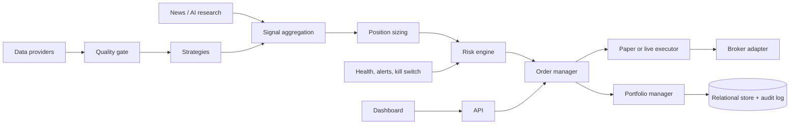

# Architecture Audit (Phase 0)

Date: 2026-10-05  
Repository: KatkarPankaj/Trading-strategy  
Scope: Non-destructive audit of the legacy implementation (baseline). Revised after verification: sections 16-18 add the required topic coverage, an evidence inventory and a status-since-baseline table.

> Reading guide. Sections 1-15 describe the repository as it was before the production migration (legacy dashboards, `src/stockmarket/*.py`). Parts of the working tree have since been extended with new modules under `src/stockmarket/core/`, `api/`, `dashboard/` and `ops.py`. Where a baseline statement is no longer true it is marked "(baseline)" and the current state is recorded in section 18.

## 1) Executive Summary

### Authorized local compatibility maintenance (2026-10-14)

After separate operator approval, checked the existing US database read-only:
schema 23 versus required 25. The old API lacked the automatic-entry pause route.
Confirmed PAPER mode, USD 100,000 cash and no positions/orders before stopping
the exact API/dashboard PIDs. These were process stops, not a demonstrated
graceful ASGI shutdown. With both ports free, made an SQLite backup, verified its
integrity and equality with the source, then explicitly applied migrations 24
(history indexes) and 25 (watchlist table). Every preexisting non-audit domain
table retained identical row counts and content hashes; integrity, foreign keys
and the audit chain passed.

Recorded a durable `PAPER_LOOP_ENTRIES_PAUSED` event through the audit repository
before startup. Restarted the existing US task with automatic migrations
disabled and the matching dashboard. API contract version 1 and all required
features are advertised; automatic entries are paused, protective monitoring is
enabled/healthy and recovery is complete without reported failures. The USD
100,000 balance and zero exposure are unchanged. Missing pre-market execution
data still leaves health degraded and entry-data readiness false. This
operational repair does not validate a fresh execution feed, India readiness,
live trading or unattended operation.

Browser validation after restart loaded Trading Monitor, System health and
Market Watch without the compatibility warning. Both previously missing API
routes returned HTTP 200. A subsequent paper-loop tick logged
`HISTORY_SNAPSHOT_CHANGED: fill replay is incomplete` during prospective
evidence reconciliation; the loop reported one failure while protective
monitoring remained healthy. No replay guard was bypassed, no new orders were
created and automatic entries remain paused. Investigate this runtime
contention/reconciliation rejection before claiming supervised auto-entry
readiness.

### AI input-limit candidate rejection fix (2026-10-14)

After entries were re-enabled, the 21:00 IST US cycle rejected SPY and QQQ
before strategy evaluation: each snapshot context was about 18.8k characters
(20 news items about 14.6k) against the 6000-character AI input default. That
rejection is fail-closed and is unchanged. The new `news_max_items` research
setting (1-20, default 20) keeps only the most recent accepted events and
records `NEWS_EVENTS_CAPPED`. `AI_MAX_INPUT_CHARS` (1000-64000, default 6000)
is now configurable. The US task uses 5 items and 16000 characters. These
changes alter research fingerprints but do not bypass AI, strategy, risk,
freshness or recovery gates. Orders still require fresh execution data and a
deterministic strategy signal.

### Dashboard readiness preflight follow-up (2026-10-14)

Browser/API inspection found a running older API: Market Watch and market
readiness routes returned 404 while the dashboard already offered Market Watch.
Its US/US_ALL loop was RUNNING but MARKET_CLOSED, with roughly 10.4-hour-old
execution data, USD 100,000 cash, no positions and no fills. These observations
do not establish India or US unattended-test readiness.

Prepared-only remediation: shared explicit dashboard contract in health; refuse
interactive rendering on missing/incompatible contracts while retaining
read-only diagnostics and explicitly warning that this does not pause an active
loop. Route-specific 404 messages identify capability mismatch. Health now
distinguishes stale/missing data inside versus outside the selected worker's
regular session without querying providers, changing timestamps or removing
entry blockers. No runtime freshness or risk threshold was relaxed.

Official NSE holiday-page retrieval again timed out. No calendar dates or
execution feed/mapping attestations were fabricated; no account currency was
changed. The running mismatch and stale-data conditions require a separately
authorized operational alignment and an actual session-time feed check, not
just code edits. See the operations preflight. This follow-up does not certify
India execution or simultaneous workers.

Validation (Python 3.11.6; disposable databases and injected providers):
`PYTHONPATH=src;tests python -m unittest test_dashboard_compatibility test_dashboard_client test_india_readiness test_market_watch -q`
passed 68 tests in 2.533s. With `PYTHONPATH=src`,
`python -m unittest discover -s tests -v` discovered 705 tests: 700 passed,
five PostgreSQL skips, zero failures/errors in 206.038s. Six new tests cover
missing/future/malformed contracts, absent capabilities, safe read-only rendering,
missing-route diagnostics and stale data inside/outside the US session.
`python -m bandit -r src\stockmarket -c bandit.yaml -ll -f json -o <session-report>`
retains the same seven pre-existing MEDIUM findings (nonzero exit), and
`python -m pip_audit -r requirements.txt` found no known vulnerabilities.
`git diff --check` and editor diagnostics passed. Existing AnyIO warnings remain.
No service restart, operator database/account mutation, migration, provider
promotion, funding conversion, commit, push or deployment was performed.

### India readiness and isolated-worker increment (2026-10-14)

Audited baseline `14a5c49e5e397f9904ebcc5607ed9743b332744c`: Market Watch already
isolates observation pools and canonical identities, but display freshness is
not feed approval. India calendars accepted bare year lists without review;
there were no explicit exceptional sessions. Bootstrap could reconstruct the
same history using a different scalar currency/seed. Execution reservations
serialize transitions, not lifetime ownership. Health considered any enabled
market's open session. All existing providers are research-only.

Implemented: separately reviewed venue calendar contracts with archived-byte and
schedule checksums, per-date publication locators, coverage/review boundaries,
and explicit special-session intervals; unreviewed India files fail closed.
One explicit market per worker, conflicting loop/universe startup rejection,
persisted market/currency/seed binding, foreign-order-history rejection and
local file-backed SQLite process lease. India requires explicit INR base cash,
no configured static FX funding, clean completed recovery and final entry-gate
revalidation. Read-only API/health/dashboard expose granular blockers without
changing Market Watch selection into execution control.

Ownership/lock order: bootstrap claims the OS sidecar lease outside SQL
transactions and before instrument bootstrap, replay or order work. The lease
does not hold a SQLite transaction. Existing execution RLock -> account
reservation -> short repository transactions remains unchanged; readiness does
no provider I/O/SQL under that RLock. Recovery readiness is in-memory replay plus
clean-reconciliation state, not a new partial-replay shortcut. ASGI shutdown stops
the loop and kill-switch monitor before closing providers/releasing ownership;
failed joins retain the lease. Database close also releases it for explicit
restart clients. Build failures release acquired leases; no background monitor
starts during composition. Immutable snapshots/order mutation still belong to
the existing TradingService/OrderManager/PortfolioManager boundaries.

No actual India date is certified: official NSE endpoints timed out and BSE
holiday/notices retrieval supplied no verifiable publication contents. Reviewed
artifact validation checks integrity and reviewer assertions, not official truth.
No production calendar, execution-authorized India feed, independently attested
mapping/entitlement, timestamped FX funding or transaction-cost approval was
invented. Provider/mapping readiness stays false; India entries remain blocked.
Local lease exclusion is not distributed account isolation or proof of safe
simultaneous US/India workers. PostgreSQL and network-filesystem ownership remain
unsupported. Existing US paper gates, risk, entry-pause, kill-switch, recovery,
protective exits and opt-in scheduling remain in force. Real-feed qualification,
completed point-in-time outcomes and OOS sample criteria precede model training;
no training, promotion, live support or profitability claim is part of this work.

Validation of this increment (configured Python 3.11.6; synthetic providers,
injected clocks and disposable SQLite files only):

```text
PYTHONPATH=src;tests
python -m unittest test_india_readiness test_market_watch test_paper_end_to_end test_trading_calendar test_paper_loop test_protective_monitor test_paper_execution_safety test_strategy_comparison test_strategy_lab test_strategy_lifecycle -q
```

137 passed in 127.681 seconds. After the final policy-compatibility adjustment,
`python -m unittest test_india_readiness -q` passed all 28 tests in 1.917 seconds.
The 28 new India/ownership/lifecycle tests include
publication/report tampering, missing/unreviewed/expired calendars, independent
venues, weekend special-session intervals, INR/FX rejection, persisted restart
identity, mixed universe rejection, final gate revalidation, interrupted replay,
local process exclusion and OS lease release after process termination.
Additional policy assertions preserve the unchanged US calendar fingerprint
shape and serialize actual venue review/special-session evidence without
discarding it or using the missing country calendar.

```text
PYTHONPATH=src
python -m unittest discover -s tests -v
python -m bandit -r src\stockmarket -c bandit.yaml -ll -f json -o <session-report>
python -m pip_audit -r requirements.txt
git diff --check
```

Final full suite: 699 discovered, **694 passed, five PostgreSQL integration
skips**, 147.613 seconds, zero failures/errors. Earlier full-suite review caught
15 calendar `asdict` serialization errors after introducing mapping proxies;
removed that representation, retained defensive copies and added an `asdict`
regression assertion before the successful final run. Existing AnyIO
ResourceWarnings remain; this is not a leak-free certification.

Bandit exits nonzero with the same seven pre-existing MEDIUM findings, compared
with the preceding milestone report: B310 in OpenAI-compatible/Finnhub HTTP
adapters, B608 at four repository SQL-construction sites, B113 in the dashboard
client. No additional findings in the final report. Dependency audit found no
known vulnerabilities; whitespace check passed. Editor diagnostics reported no
errors in touched Python files. No configured repository-wide type gate exists;
the signature helper reported six fixture call incompatibilities for the
unchanged public bootstrap signature, although those runtime calls passed.
The editor test runner did not discover the new module; unittest was executed
directly instead. No services were restarted, no operator database or credentials
were modified, and no migrations, commits, pushes or deployments were performed.
The revised dashboard was validated through mocks/API tests, not a restarted UI.

### US/India Market Watch vertical slice (2026-10-14)

Audit: `ApiContext.instruments` is the shared canonical master loaded from
repositories; vendor providers do not create instruments. MarketRegistry already
defines US/IN/DE, Yahoo maps MIC suffixes and Twelve Data sends venue identity.
Portfolio accounting has per-currency cash and explicit FX, not automatic cash
conversion. Risk uses explicit instrument-local entry limits. Bootstrap constructs
one PaperTradingLoop/ProtectiveMonitor with one selected market and universe.
The dashboard previously had only a monitoring markets table. India has no
bundled verified holiday coverage. Existing unrelated protective/recovery changes
were preserved.

Implemented slice: shared core MarketWatch; V25 repository-backed canonical-ID
watchlist; authenticated search/watch/explicit-refresh API; dedicated sidebar
Market Watch page. GET never calls vendors. Worker pools, circuits, quote caches
and single-flight admission are per market and separate from execution. Quotes
never feed an order from this page. Source timestamps and freshness are explicit;
invalid/missing prices are null and synthetic providers are labeled. Vendor
alias maps are separate from the canonical master. Scoped Twelve Data credentials
and pacing are shared configuration logic, not exposed API state.

Calendar override directory supports independent venue files with US country
fallback (India now requires venue review as described above). Exchange phase is exact; country execution is conservative on
disagreement, and flattening uses earliest venue close. Uncovered dates remain
closed. US DST and India fixed-offset tests use deterministic clocks.
No official India calendar could be fetched, so none was fabricated or bundled.
The loop explicitly reports SINGLE_MARKET; simultaneous automation is not
implemented/certified by a multi-market watch page. USD cash is not INR funding.

Limits: 100 shared watchlist members, 10 refreshed per market, five-second
admission budget plus bounded read wait, no distributed vendor-wide quota,
single-worker SQLite operating model. Late timed-out reads cannot publish;
underlying vendor calls are not cancelled. Special weekend/Muhurat sessions and
verified India holiday coverage remain unsupported. No operator migrations,
credential edits, running-service restart, deployment, commit or training.
See [operations](OPERATIONS.md#market-watch-us-and-india-observation-slice).

Validation (configured Python 3.11.6; `PYTHONPATH=src;tests` for named modules):

- Editor test runner could not discover this unittest module; terminal unittest
  was used. First focused new run exposed eight implementation errors (repository
  query API and static normalizer alias use); fixed before successful runs.
- `python -m unittest test_market_watch -v`: 19 passed, 0.430s at that checkpoint.
  Two later regression tests cover disabled-market membership and visible API
  errors; all 21 new tests are included in the final focused/full results below.
- `python -m unittest test_market_watch test_trading_calendar test_market_data_providers test_twelvedata_provider test_paper_loop test_protective_monitor test_personal_research test_dashboard_client test_paper_execution_safety`:
  130 passed, 10.934s.
- `PYTHONPATH=src python -m unittest discover -s tests -v`: final 671 discovered,
  **666 passed, five optional PostgreSQL skips, zero failures**, 147.862s.
  This includes earlier uncommitted protective-exit/recovery changes. AnyIO
  stream ResourceWarnings persist; successful tests do not establish leak-free
  operation.
- `python -m bandit -r src\stockmarket -c bandit.yaml -ll -f json -o <session-report>`:
  exit 1, seven existing MEDIUM findings (B310 provider HTTP transport sites;
  B608 existing repository SQL identifiers; B113 existing computed client timeout),
  no new scanner findings. Existing suppression-comment warnings remain.
- `python -m pip_audit -r requirements.txt`: exit 0, no known vulnerabilities.
  No packages were added or installed.
- Pylance/editor checks: no errors in changed watch/provider/API/UI files;
  MarketWatch has no syntax errors or diagnostics. Signature compatibility
  verified 21 MarketDefinition.phase callers and one Twelve Data normalizer
  caller. There is no configured repository-wide lint/format/type-check gate.
- `git diff --check`: clean. Existing user/uncommitted work preserved. No browser
  test of the revised deployed UI is claimed: services were not restarted and
  the real operator database was not migrated. New-page behavior is covered by
  deterministic UI-handler/API tests, not a live-feed certification.

Current personal-research update: the empty instrument selector was traced to
API startup reading an unpopulated instrument repository; registry universes and
price providers do not discover a master. Explicit development/configured JSON
bootstrap now imports validated canonical records transactionally through the
existing repository and preserves existing metadata. Personal recommendation
composition reuses scanner, ORB/VWAP, candidate snapshots and optional existing
AI assessment/ranking; V15 persists runs. PERSONAL_RESEARCH blocks execution
mutations and halts the entry gate. India remains unsupported by the available
holiday-calendar coverage, and no real AI access or usable market data should be
inferred from registry population. See [Personal Research](PERSONAL_RESEARCH.md).

International personal-research update: backend MarketProfileService composes
existing market definitions, calendar coverage, research-session policy,
registered strategies and single-country universes. Authenticated market status
drives Auto/manual dashboard selection, including DST and visible unsupported
years. Personal startup enables registered research markets independently of the
execution-account default and supplies overridable research policies without
requiring AI. Runs persist selected/resolved context; replay retains it.
US/Xetra coverage remains 2026 only; India is unsupported and the development
master has no German instruments. No broker/order safety boundary was relaxed.

Real-AI verification found that repeating a valid long assessment explanation
could exceed the strategy-selection input limit. Candidate prompt v2 omits only
that redundant prose from selection and uses compact serialization; full
explanation/evidence remain persisted, and oversized inputs still fail closed.
A real OpenAI call over synthetic US fixture data completed both AI stages after
the fix, without orders/fills. Current India calendar and Germany master gaps
remain unresolved; this does not establish real-market recommendation readiness.

The repository is a working paper-trading/research simulator with useful features (strategy scoring, backtest, parameter sweep, paper portfolio, and Streamlit dashboards), but it is currently a monolith around India intraday assumptions and UI-driven orchestration.

It is not yet production-grade for live execution and not yet globally extensible by architecture. The highest-risk gaps are:

- Tight coupling of business logic to Streamlit UI state.
- No broker abstraction and no live/paper execution boundary as separate engines.
- No formal risk engine with mandatory pre-trade checks and explicit reject reasons.
- Market assumptions hard-coded across modules (time window, timezone, symbols, session hours).
- File-based mutable state with no transactional guarantees.
- Data-provider reliability and validation safeguards are partial.
- Limited automated testing footprint (baseline: no test suite was detected; see section 18).

## 2) Current Architecture

## 2.1 Source Layout

Primary code paths are:

- dashboard.py (large advanced Streamlit app with scanning, paper execution, strategy tracking, persistent pending orders, and learning heuristics)
- dashboard_simple.py (lightweight Streamlit app with signal ranking + auto paper cycle + state snapshots)
- src/stockmarket/config.py (TradingConfig dataclass)
- src/stockmarket/data.py (Yahoo fetch + cache)
- src/stockmarket/strategy.py (ORB + VWAP signal columns)
- src/stockmarket/backtest.py (single-position-at-a-time backtest)
- src/stockmarket/sweep.py (parameter sweeps)
- src/stockmarket/cli.py (backtest/signal/sweep/replay commands)
- src/stockmarket/webapp.py (legacy streamlit frontend invoking core functions)

## 2.2 Architectural Style Observed

Current style is a hybrid:

- Library-style modules in src/stockmarket for data, strategy, backtest, CLI.
- Two UI-first apps that also host core domain logic and execution logic.
- File persistence (JSON/CSV) used as system-of-record for paper state and history.

No explicit domain-layer boundaries currently exist for:

- instruments
- orders and order lifecycle
- broker adapters
- risk decisions
- portfolio engine
- market sessions/calendars
- audit and event store

## 3) Current Data Flow

## 3.1 Market Data

- Yahoo path:
  - src/stockmarket/data.py fetch_intraday_data downloads yfinance bars, standardizes columns, converts timezone, filters fixed session window, and caches with pickle.
- NSE quote path:
  - dashboard.py and dashboard_simple.py call nsepython directly for quote-equity endpoint.

Observations:

- Data-provider calls are made directly in dashboards and strategy orchestration, not behind an abstract provider interface.
- Session filtering in src/stockmarket/data.py is hard-coded to 09:15-15:30.
- There is retry/backoff for Yahoo only; no comprehensive stale/missing/duplicate timestamp quality gate that blocks trading globally.

## 3.2 Configuration

- config.json and config.example.json load into TradingConfig.
- Many runtime behaviors in dashboards are side-bar controls and session_state values beyond TradingConfig.

Observations:

- Typed config is present but incomplete for production concerns (environment, secrets, runtime mode, broker config, risk policies).

## 4) Current Strategy Flow

- Core indicator/signal generation in src/stockmarket/strategy.py:
  - OR high/low, VWAP, volume spike, long_signal, short_signal.
- Dashboard-level strategy scoring and plan generation:
  - dashboard.py has mode-specific score_signal and separate quote-based/yahoo-based planning.
  - dashboard_simple.py has separate ranking logic with regime-like hints and learning score adjustments.

Observations:

- Strategy semantics are duplicated across files.
- No common Strategy interface returning a normalized Signal object.
- Multiple ad-hoc signal formats exist (DataFrame columns, dict plans, UI labels).

## 5) Current Execution Flow

## 5.1 Backtest

- src/stockmarket/backtest.py simulates entries/exits from long_signal/short_signal.
- Applies slippage and commission, with stop/target/time/square-off exits.

Limitations:

- Simplified fill model (single-bar checks, no partial fills, no latency model, no order queue model).
- One-in/one-out intraday position model per day loop; no portfolio-level cross-symbol constraint engine.

## 5.2 Paper Trading (Dashboards)

- Both dashboards contain direct order execution functions mutating state and writing files.
- Position and cash calculations are embedded in UI script runtime.

Limitations:

- No standalone OrderManager state machine.
- No broker adapter abstraction even for paper path.
- Idempotency and duplicate-order defenses are not formalized as a reusable service.

## 6) Current Persistence

Current persistent artifacts:

- JSON state files (for active paper session)
- CSV ledgers/history/daily summaries
- Snapshot JSON files
- Cached market data pickle files in .cache

Risks:

- No transactional integrity or locking model.
- Concurrent writes/race conditions possible if multiple instances run.
- Pickle usage in cache has integrity/security implications if cache files are tampered with.
- No normalized relational schema for orders/fills/positions/risk decisions.

## 7) Current Risk Controls (What Exists)

Positive controls detected:

- Per-trade and per-position checks in dashboards (qty/notional limits, margin/cash checks).
- Entry windows and square-off windows.
- Stop-loss and take-profit calculations.
- Max trades/day and max open positions controls.
- Additional quality gates in advanced dashboard (score, reward/risk, expected edge).

Critical gaps:

- No centralized non-bypassable RiskEngine component.
- No explicit RiskDecision object with approved/rejected + reason ID.
- No comprehensive portfolio-level exposure/correlation/sector constraints at engine level.
- No global kill switch framework decoupled from UI.

## 8) Key Weaknesses and Coupling

## 8.1 UI-Business Logic Coupling

- Streamlit session_state is used as a de facto domain store and orchestration layer.
- Order execution, risk checks, ranking, persistence, and analytics are mixed with rendering code.

Impact:

- Hard to test deterministically.
- Hard to reuse logic for API/live execution.
- Increased regression risk when changing UI.

## 8.2 Duplicated Logic

Examples:

- Charges and trade accounting logic appear in both dashboards.
- Signal ranking and strategy plan logic are split and partially duplicated.
- Separate persistence conventions across dashboards (different state formats/files).

## 8.3 Error Handling Pattern

- Many broad except Exception blocks with continue/pass fallback behavior.

Impact:

- Operational faults may be suppressed.
- Difficult root-cause analysis.

## 8.4 Documentation Drift

- DOCUMENTATION.md contains statements that diverge from current code in places (for example, references to implementation details not matching current file behavior and legacy descriptions).

## 9) Security Issues and Risks

1. config.json is tracked and currently includes runtime settings. No dedicated secret handling strategy is implemented (even though values shown are non-secret at present).
2. .env is ignored, but no .env.example exists to enforce secret separation conventions.
3. Cache uses pickle load/dump; tampered local cache files can be a code-execution vector in hostile environments.
4. Extensive file writes from UI loops without integrity checks/audit signatures.
5. No structured redaction rules for logs/history if sensitive fields are introduced later.

## 10) Production Blockers

1. No paper/live hard separation with safety gates.
2. No broker adapter interface or live execution service.
3. No typed, environment-aware production settings model.
4. No database persistence layer with migration/versioning.
5. No service/API layer for headless operation; logic tied to dashboards.
6. No comprehensive automated tests for risk/order/execution invariants.
7. No observability baseline (structured logs, health checks, alerts).

## 11) Internationalization Blockers

1. Hard-coded market assumptions:
   - Asia/Kolkata defaults
   - 09:15 / 15:15 / 15:30 session logic
   - Fixed India watchlists and .NS-centric symbol sets
2. Session filtering in data layer fixed to India regular hours.
3. Strategy execution windows and day-boundary logic are exchange-specific and embedded in dashboards.
4. Currency assumptions are INR display-centric in UI/accounting labels.

## 12) Dead Code / Fragility Indicators

- src/stockmarket/webapp.py appears to be a legacy UI path while dashboards dominate interactive usage.
- Multiple paths produce overlapping outputs, increasing maintenance burden.
- No tests directory was present at baseline; behavior relied on manual run-time validation (see section 18 for the current test suite).

## 13) Recommended Migration Plan (High-Level)

The following plan is incremental and preserves current working functionality.

Phase A: Foundation (no behavior break)

1. Introduce new package skeleton for layered architecture (core/data/strategies/risk/execution/brokers/persistence/monitoring/config/api).
2. Add typed settings loader (env + json overlays) and explicit runtime mode flags.
3. Create domain models for Instrument, Signal, Order, Position, RiskDecision.

Phase B: Extract and Stabilize Engines

1. Extract paper order execution from dashboards into PaperExecutor + OrderManager.
2. Introduce RiskEngine as mandatory pre-trade gate used by paper executor.
3. Add MarketSession abstraction and move all time-window logic out of strategy/UI.

Phase C: Provider Abstraction

1. Define MarketDataProvider interface and adapters:
   - YahooResearchProvider
   - NSEQuoteProvider (research/paper)
2. Implement data quality checks (stale/missing/duplicate timestamp validation) and fail-closed trade gating.

Phase D: Persistence and Audit

1. Add repository layer with SQLite first, PostgreSQL-ready schema.
2. Persist signals, orders, fills, positions, risk decisions, and event logs.
3. Keep CSV exports as derived artifacts, not source-of-truth.

Phase E: API + Dashboard Decoupling

1. Create FastAPI read/write endpoints.
2. Refactor Streamlit dashboards to consume service/API interfaces only.
3. Mark trading mode prominently (PAPER/LIVE).

Phase F: Testing + Ops

1. Add unit/integration tests for:
   - risk limits
  - order state transitions
   - data validity gates
   - portfolio accounting
2. Add CI checks: lint, type-check, tests, dependency/secret scanning.
3. Add structured logging + health probes + alerts.

## 14) Priority Risk Matrix

Critical:

- Missing non-bypassable risk engine
- UI-driven execution path
- No hard paper/live gate framework

High:

- Hard-coded market/session assumptions
- File-based mutable state and weak fault tolerance
- Provider abstraction missing

Medium:

- Duplicate strategy/ranking logic
- Documentation drift
- Broad exception suppression

## 15) Phase 0 Deliverables Completed

- Inspected repository source modules, dashboards, config files, requirements, and documentation.
- Produced this non-destructive architecture audit.
- Verified and completed the audit against the 16 required topics (sections 16-18).

No runtime trading logic, `config.json`, or dashboard behavior was modified by the audit work.

## 16) Required Topic Coverage

| # | Required topic | Where covered |
|---|---|---|
| 1 | Current architecture | 2, 16.1 |
| 2 | Current data flow | 3, 16.2 |
| 3 | Current strategy flow | 4, 16.3 |
| 4 | Current backtesting | 5.1, 16.4 |
| 5 | Current paper trading | 5.2, 16.5 |
| 6 | Portfolio / PnL | 16.6 |
| 7 | Configuration | 3.2, 16.7 |
| 8 | Dashboard | 8.1, 16.8 |
| 9 | Tests | 16.9, 18 |
| 10 | Security | 9, 16.10 |
| 11 | Risk management | 7, 16.11 |
| 12 | NSE / India-specific assumptions | 11, 16.12 |
| 13 | Internationalization blockers | 11, 16.13 |
| 14 | Production blockers | 10, 16.14 |
| 15 | Recommended target architecture | 13, 16.15 |
| 16 | Recommended migration sequence | 13, 16.16 |

### 16.1 Current architecture (legacy baseline)

- Two Streamlit applications carry most of the domain logic: `dashboard.py` (3,747 lines, 70 module-level functions) and `dashboard_simple.py` (1,980 lines, 30 module-level functions). They contain scanning, ranking, learning heuristics, paper order execution, charges, persistence and rendering.
- The library layer is small: `backtest.py` (407 lines), `cli.py` (538), `data.py` (168), `strategy.py` (85), `sweep.py` (74), `webapp.py` (170), `config.py` (47).
- There are no domain boundaries for instruments, orders, brokers, risk decisions, portfolio or audit in the legacy code.

### 16.2 Current data flow

- Yahoo path: `data.py` downloads via `yfinance`, normalizes columns, converts timezone, filters the configured session and caches locally (baseline cache format: pickle; now Parquet).
- NSE quote path: both dashboards import `nsepython.nsefetch` and call NSE quote endpoints directly (`fetch_nse_quote`, `_fetch_nse_quote_payload`, `scan_top_stocks_nse`).
- Data access is not behind an interface; dashboards call providers inline. Retry/backoff exists for Yahoo only. There is no stale/missing/duplicate-data gate that globally blocks trading.

### 16.3 Current strategy flow

- `strategy.py` adds opening-range high/low, VWAP, volume-spike and `long_signal`/`short_signal` columns to an OHLCV frame.
- `dashboard.py` re-implements planning and scoring (`_strategy_plan_from_yahoo`, `_strategy_plan_from_nse_quote`, `score_signal`, `scan_top_stocks`) and `dashboard_simple.py` has a separate ranking (`_rank_signals`, `_estimate_regime_from_symbols`).
- Signals exist in three shapes: DataFrame columns, dict plans, and UI labels. No common Strategy interface exists.

### 16.4 Current backtesting

- `backtest.py` simulates one position at a time per day with slippage, commission, stop/target/time exits and square-off, using next-bar-open entries and mark-to-market equity.
- Gaps (baseline): no partial fills, no latency model, no spread, no holiday calendar, no corporate actions, single instrument, no portfolio limits. `sweep.py` runs parameter grids over this engine. A walk-forward validation package (`validation/`) and robustness scenarios already exist for the legacy engine.

### 16.5 Current paper trading

- Paper execution lives in the dashboards: `_execute_paper_order`, `_auto_trade_engine`, `_auto_exit_before_close`, `_add_pending_buy_order` / `_arm_symbol` (dashboard.py) and `_auto_paper_cycle`, `_record_trade` (dashboard_simple.py).
- Cash, margin, holdings and pending orders are mutated inside Streamlit session state and written to local files. There is no order state machine, idempotency or broker abstraction in the legacy path.

### 16.6 Portfolio / PnL

- Positions, cash and margin are dictionaries in `st.session_state`; `_portfolio_snapshot` and `_current_open_pnl` derive values for display. Charges are computed separately in each dashboard (`_intraday_charges`).
- PnL history is appended to CSV (`daily_pnl_history.csv`, `paper_trade_history.csv`; `simple_trade_ledger.csv`, `simple_daily_summary.csv`) plus JSON state and timestamped snapshots under `outputs/`.
- Weaknesses: single currency (INR) implied, no realized/unrealized separation as a reusable service, no drawdown or monthly PnL tracking outside display code, duplicated accounting between the two apps.

### 16.7 Configuration

- `config.json` (tracked, 20 lines) and `config.example.json` load into `TradingConfig` (47 lines). Defaults are India-centric: `RELIANCE.NS`, `Asia/Kolkata`, 09:15 open, 15:30 close, 13:30 entry cutoff, 15:15 square-off.
- Dashboards read `config.json` at runtime and add many sidebar/session_state controls that are not part of `TradingConfig` (146 `session_state` references in `dashboard.py`, 165 in `dashboard_simple.py`; UI preferences are persisted by `_load_saved_ui_preferences`).
- No environment concept, no secret handling and no startup validation of mandatory production settings (baseline).

### 16.8 Dashboard

- Both dashboards combine rendering with orchestration, risk checks, order execution, persistence and learning. `webapp.py` is an older UI over the library modules.
- Consequences: logic cannot be unit-tested without Streamlit, cannot be reused by an API or live path, and the two apps drift (separate state formats, duplicated charges and ranking).
- Naive-time risk: `datetime.now()` without a timezone appears 8 times in `dashboard.py` and once in `dashboard_simple.py` next to timezone-aware helpers (`ist_now`, `market_now`).

### 16.9 Tests

- Baseline: none. Current: 15 test modules, 144 tests, all passing (see section 18).
- Legacy dashboards remain untested because their logic is coupled to Streamlit.

### 16.10 Security

- Baseline findings are listed in section 9. Additional observations: `nsepython` relies on unofficial calls to NSE website endpoints (availability and terms-of-use should be reviewed); dashboards write state files with no integrity protection; 34 broad `except Exception` handlers in `dashboard.py`, 11 in `dashboard_simple.py`, 3 in `data.py` and 4 in `webapp.py` can hide failures.
- `config.json` is tracked in git; `outputs/` and `.cache/` are not tracked (0 tracked files under `outputs/`).

### 16.11 Risk management (legacy)

- Controls exist but are scattered in dashboard functions: `_passes_buy_quality_gate`, `_expected_edge_after_costs`, `_max_allowed_buy_qty`, `_enforce_existing_position_qty_cap`, `_estimate_buy_block`, entry/square-off/auto-exit windows, max trades per day and open-position limits, stop-loss/take-profit.
- `_auto_tuned_quality_filters`, `_apply_learning_bonus`, `_update_learning_memory` and `_agent_tuning_plan` adjust thresholds from recent results with no minimum sample size or out-of-sample check. This conflicts with the rule that live parameters must not change from a small sample.
- No central, non-bypassable RiskEngine, no RiskDecision with reason codes, no portfolio-level sector/correlation/drawdown limits, no kill switch (baseline).

### 16.12 NSE / India-specific assumptions discovered

1. Default symbol and watchlists are NSE tickers with the `.NS` suffix: 30+ symbols in `dashboard.py` (lines 34-41) and 12 in `dashboard_simple.py`; the symbol-to-sector map (lines 45-74) and cap-bucket map (lines 78+) are Indian equities only.
2. `config.py` defaults: `market_timezone="Asia/Kolkata"`, `market_open_time="09:15"`, `market_close_time="15:30"`, `entry_cutoff_time="13:30"`, `square_off_time="15:15"`; `config.json` and `config.example.json` repeat them.
3. `nsepython.nsefetch` quote endpoint in both dashboards; `_to_nse_symbol` converts symbols to NSE format.
4. Indian intraday charge model in `_intraday_charges` (both dashboards): brokerage, exchange transaction charge, SEBI turnover fee (turnover x 0.000001), 18% GST on fees, stamp duty, and STT of 0.025% on the sell side (dashboard_simple.py lines 245-249).
5. `ist_now()` helpers (both dashboards) and market-phase logic fixed to IST.
6. Currency is implicitly INR in accounting and display.
7. Market-cap quota, price-band and cap-focus filters (`_apply_market_cap_quota`, `_apply_price_band_filter`, `_apply_cap_focus_filter`) assume Indian large/mid/small-cap buckets and INR price bands.
8. Titles and help text name NSE/BSE (`cli.py` line 61, `webapp.py` line 18, `dashboard.py` line 2).
9. `requirements.txt` includes `nsepython` as a hard dependency.
10. No holiday calendar: weekends only are implied; exchange holidays are not modeled in the legacy engine.

### 16.13 Internationalization blockers

- Items 1-10 above, plus: session filtering and entry/exit windows live in dashboards and strategy configuration rather than a market definition; symbol conventions are Yahoo `.NS`-centric; charges, lot size and tick size are not instrument attributes; there is no multi-currency accounting in the legacy path.

### 16.14 Production blockers (baseline)

See section 10. In short: no paper/live separation, no broker abstraction, no central risk gate, no typed environment configuration, no relational persistence or migrations, no API layer, no automated tests, no observability, no CI, no container or deployment assets.

### 16.15 Recommended target architecture



- Strategies and AI only produce signals or research; only the order manager can create orders, and only after a risk decision.
- Market, instrument, calendar and currency facts come from definitions, not code. Paper is the default; live requires explicit configuration and passing safety gates.

### 16.16 Recommended migration sequence

1. Domain models and market/instrument definitions. 2. Market sessions and calendars. 3. Data-provider interface with quality gates. 4. Strategy interface (migrate ORB/VWAP, add regime filter). 5. Risk engine and position sizing. 6. Portfolio and order manager. 7. Paper/live executors and broker adapter. 8. Backtesting upgrade and anti-overfitting. 9. Persistence, audit trail and versioning. 10. Observability, kill switch and recovery. 11. API, then dashboard on the API. 12. Tests, CI and security scanning. 13. Docker and deployment. 14. Documentation. 15. Retire legacy dashboards.

## 17) Evidence Inventory (verified)

| Item | Value |
|---|---|
| `dashboard.py` / `dashboard_simple.py` | 3,747 / 1,980 lines; 70 / 30 module-level functions |
| Streamlit `session_state` references | 146 / 165 |
| Broad `except Exception` / bare `except` | 34 / 11 (dashboards), 3 (`data.py`), 4 (`webapp.py`) |
| Naive `.now()` calls | 8 / 1 |
| India-specific matching lines | `dashboard.py` 180, `dashboard_simple.py` 48, `config.py` 6, `cli.py` 7, `config.json` 4, `config.example.json` 6 |
| Persisted legacy files | `outputs/paper_state.json`, `paper_trade_history.csv`, `daily_pnl_history.csv`; `simple_paper_state.json`, `simple_trade_ledger.csv`, `simple_daily_summary.csv`, `snapshots/` |
| Tracked in git | `config.json` yes; `outputs/` none |

## 18) Status Since Baseline

The repository now also contains a new platform layer. The table records the difference from the baseline findings so the audit is not misleading.

| Baseline finding | Current state |
|---|---|
| No tests | 40 test modules, 368 tests passing in the full local unittest run (Milestone 1 gap audit). Since the 304-test update, coverage was added for market profiles/Auto market resolution, personal research, instrument bootstrap/import and the Twelve Data provider. Earlier coverage includes domain models, instruments, market sessions/calendars, provider validation/resilience and quote-snapshot consistency, deterministic ORB/VWAP signals and strategy-to-aggregation guards, market-regime classification, AI strategy-ranking validation, timestamped research evidence, AI news/sector/fundamental evidence production, provider-to-aggregation strategy-pipeline behavior, authenticated API research requests and response validation, authenticated dashboard API client and read-only research UI behavior, explicit PAPER TradingService/RiskEngine routing and rejection, real PaperBroker fill and portfolio accounting, pipeline-linked decision/evidence/order audit persistence, portfolio rebuild and clean restart reconciliation, news, legacy paper order management, risk engine, portfolio risk, sizing, portfolio manager, signal aggregation, backtest validation, performance statistics, robustness, walk-forward and validation CLI/reports. This update adds persisted TradeProposal/risk-evaluation coverage for BUY/SELL, sizing and risk rejection, missing FX/stale/future inputs, idempotency, and no order/portfolio mutation. Yahoo earnings observations and NSE sector-index evidence are opt-in, require explicit configuration, and are not configured by default; NSE instrument/index membership is operator-maintained, and endpoint availability is not guaranteed. No committed tests yet cover kill switch, learning registry, API order/recovery workflows, or live-readiness modules. |
| No central RiskEngine | `core/risk.py` and `core/risk_portfolio.py` exist; legacy dashboards do not call them. |
| No order state machine / paper-live split | `core/order_management.py`, `core/executors.py`, `core/brokers.py` exist (paper default, live gated); legacy dashboard order execution is now disabled and fails before mutation, but legacy local paper state is still mutated (see 18.1). |
| Pickle cache | `data.py` now writes Parquet. |
| No .env.example, unpinned dependencies | `.env.example` added; `requirements.txt` pinned. |
| No persistence layer / API / observability | `core/persistence/`, `api/`, `core/observability/` exist and are not used by the legacy dashboards. |
| No data-provider interface | `core/data/` (interface, mock, Yahoo adapter, factory, quality gates, resilience) exists. The API paper path now uses the configured provider through `ResilientProvider`; legacy `data.py` and dashboards still call Yahoo/NSE directly. |
| No research evidence producers | `core/research.py` includes news and provider-neutral sector/fundamental producers. They validate instrument identity, market, timestamp and age, then use a strict AI scoring schema and retain hashed provenance. Opt-in Yahoo reported-EPS and NSE sector-index adapters are available. NSE use requires an explicit, operator-reviewed symbol→index map and is limited to XNSE instruments; mapping membership is not inferred or refreshed, and automated access can be blocked or rate-limited. No provider or map is configured by default. |
| No regime engine, no Strategy interface | `core/strategies/` defines a shared contract and an ORB/VWAP implementation producing `Signal` objects. `SignalAggregator` accepts that output, uses it as the authoritative technical direction, rejects stale/unpriced/mismatched signals, and prevents HOLD or opposing research evidence from authorizing the reverse direction. `core/regime.py` evaluates a validated rolling bar window and exposes a bounded supporting score. `core/ai/analyst.py` returns structured, identity-/time-bound rankings restricted to caller-supplied strategy names; failures and invalid candidates produce no selection. `core/strategy_pipeline.py` composes provider, regime, optional AI news/sector/fundamental evidence, AI strategy selection, deterministic signal and aggregation with fresh, instrument-matched evidence. Its legacy `submit_decision()` entry is now fail-closed; only persisted Phase 2C-3 approvals can proceed through the PAPER lifecycle. Paper fills are order-linked and deterministically persisted; the legacy DataFrame-based implementation remains in use by backtests and dashboards. |
| No research API | Authenticated `POST /research` runs an advisory pipeline without submitting orders. Bootstrap accepts injected components or an explicit OpenAI-compatible HTTPS endpoint through `AI_BASE_URL`, `AI_MODEL`, `AI_API_KEY`/`AI_API_KEY_FILE`, plus validated `RESEARCH_SESSIONS`. These remain unset by default. Requests fail closed when session configuration or market-local calendar/trading-day coverage is unavailable. The API-backed dashboard exposes research, opportunity ranking, paper order review and explicit proposal acceptance; it still surfaces authenticated API errors. |
| No separate market-intelligence service / `TradeProposal` | `core/market_intelligence.py` provides a timestamped orchestrator over the existing regime/news/strategy/aggregation pipeline, with authenticated `POST /intelligence/opportunities`. It ranks candidates deterministically and returns explainable advisory proposals with `risk_status=NOT_EVALUATED`; those in-memory objects cannot be submitted. The submission endpoint accepts only persisted approved Phase 2C-3 proposals and routes them through `TradingService`/`RiskEngine`. Finnhub news and OpenAI analysis remain opt-in; Finnhub requires a secret and explicit symbol translations outside US. |
| No persisted signal sizing/risk proposal stage | `core/trade_proposals.py` consumes a persisted Phase 2C-2 signal, revalidates its linked PAPER run/research context, freshness, market session, instrument and configured FX, performs deterministic account-currency sizing, applies the existing `RiskEngine`, and persists risk decisions plus approved terminal TradeProposals in migration V11. Phase 2C-4 explicitly submits only those durable approvals, revalidating provenance and current data; order claims, orders, order-linked fill IDs, and portfolio snapshots are persisted. Phase 2C-5 uses persisted proposal-linked positions and deterministic quote-triggered stop/target exits through the same order/risk boundary; V12 stores exit proposals. Phase 2C-6 persists PaperBroker order attempts, accepted executor orders, and fill sequence (V13), with restart reconciliation and retry only when durable executor state proves non-acceptance. Phase 2C-7 provides a bounded, manually triggered PAPER cycle with idempotency, candidate checkpoints/events, account-scope lease/expiry (V14), and explicit API/CLI recovery. Neither cycle execution nor exit monitoring is scheduled or unattended; active-order reservations remain process-local. Timestamped FX observations and cross-process portfolio reservations remain gaps. |
| No CI | `.github/workflows/ci.yml` runs the unittest suite, Bandit and pip-audit for Python 3.11. The latest observed run failed during dependency installation because the pinned FastAPI/Uvicorn versions conflicted with Streamlit; compatible pins are now updated locally, but a fresh remote run is still required. CI does not constitute production or live-trading validation. |
| No docs set | `docs/ARCHITECTURE.md` records target boundaries and integration sequence; `docs/OPERATIONS.md` now documents local/Compose operations, secrets, migrations, backup/restore, and limitations. `DOCUMENTATION.md` remains legacy-app focused. |
| No deployment setup | Dockerfile, Compose, backup script and a hardened systemd unit already existed before this phase. `docs/OPERATIONS.md` documents the supplied paper-only Compose/systemd paths and their limitations; deployment has not been executed or certified in this environment. |
| Legacy dashboards contain business logic | `src/stockmarket/dashboard/` is the separate API-backed dashboard for research/opportunity ranking, order review and guarded proposal acceptance. `dashboard.py`, `dashboard_simple.py` and `src/stockmarket/webapp.py` remain distinct legacy workflows and have not been migrated into platform services; their local paper state and safeguards remain untouched. |
| Market sessions / calendar coverage | `core/trading_calendar.py` supports covered-year fail-closed behavior, holidays, weekends, early closes and recurring intraday pauses; the API rejects research requests on uncovered or closed dates. US and Xetra have 2026 holiday data; India remains uncovered until NSE and BSE official schedules are both verified and reconciled. Future years fail closed. |
| India-specific assumptions | Still present in legacy paths (section 16.12). `core/markets.py` defines US, IN and DE; India remains calendar-uncovered until both NSE and BSE official schedules are verified and reconciled. |

### 18.1 Platform gap matrix (Milestone 1 audit)

The matrix was verified against source and tests, not documentation. Status values: **Done** = implemented and tested; **Partial** = implemented but incompletely integrated or tested; **Missing**; **Unsafe** = an inconsistency that can mislead decisions.

| Area | Status | Evidence / gap |
|---|---|---|
| AI ranks only deterministic candidates; cannot override HOLD | Done | `ai/schemas.py` instructs ranking of supplied candidates only; `market_intelligence.py` ranks only completed BUY/SELL pipelines with a matching strategy signal; `aggregation.py` maps HOLD to no prices. |
| AI strategy selection restricted to registered strategies | Done | `autonomous_research.py` validates allowlists; tests in `test_ai_strategy_selection.py`, `test_autonomous_research.py`. |
| Strategy catalogue | Partial | ORB/VWAP is the only concrete strategy (`core/strategies/orb_vwap.py`). Momentum/mean-reversion/trend/news are aggregation components, not strategies. |
| Quantitative pre-screen before AI | Partial | Scanner ranking, `top_n` 1–10, max 50 candidates, cache, 20 s timeout. No token budget or per-run AI cost accounting. |
| AI output schema | Partial | Strict (`extra="forbid"`) classification, confidence, risks, evidence IDs and invalidation conditions. No explicit `NO_TRADE`, contradictory evidence, evidence quality, rejection reasons, source URLs or component-score object. |
| Research persistence / reproducibility | Done | Research runs, snapshots, evidence, model/prompt/schema versions, request hash and idempotency key are persisted. |
| Signal semantics | Unsafe | `SignalSide` is BUY/SELL/HOLD only. Open vs close and long vs short are resolved later from position state (`execution.py` maps SELL to SELL or COVER). There is no distinct `SELL_TO_CLOSE`/`SHORT_SELL`/`COVER`/`NO_TRADE` intent. |
| Outcome feedback loop | Missing | `learning.py` holds structures only. Realized paper outcomes do not feed back into ranking or strategy selection. No tests exist. |
| Runtime evidence | Partial | Finnhub news is wired only when configured; fundamental/sector producers are opt-in. Missing evidence suppresses AI scoring. |
| Provider research-only flag | Done | Yahoo, Twelve Data and Mock are `research_only`. `live_readiness.py` rejects them by provider name (`_RESEARCH_ONLY`), not by the provider's flag. |
| Data quality gates | Done | `core/data/quality.py` (missing/duplicate/out-of-order/non-finite/OHLC/frozen/gap/future/stale) is enforced via `ResilientProvider`. Freshness is enforced only when `require_fresh=True`. |
| Rate limits / retries | Partial | `retry_after` is honoured, capped by `max_rate_limit_wait`, but the final error reports a generic "failed after retries: ConnectionError". Twelve Data has an RPM throttle but no bar cache. |
| Per-market provider routing / entitlement | Missing | One global provider (`factory.py`). Twelve Data free plan covers US only; XETR/NSE need a paid plan. Entitlement is not checked before use. |
| Calendars | Partial | US and DE 2026 covered; India `UNSUPPORTED_CALENDAR`; later years fail closed; DST is handled via `zoneinfo`. |
| Corporate actions | Missing | Yahoo requests unadjusted bars; there is no adjustment metadata on bars. |
| Data provenance persistence | Partial | Research evidence records source/timestamps/quality. Individual provider fetches and quality reports are not persisted. |
| Short eligibility | Partial | `risk.py` and `trade_proposals.py` reject SELL entries unless `shortable is True`. There are no market-specific rules (for example India intraday-only shorting) and no borrow availability. |
| Streaming / WebSocket | Missing | Providers are REST only. |
| API mutation routes go through risk | Done | All mutating routes require auth; orders and proposals pass through `TradingService`/`RiskEngine`. |
| Legacy dashboard order execution | Done (disabled) | `_execute_paper_order` raises before mutation in both legacy dashboards (`test_legacy_execution_boundary.py`). |
| Legacy dashboard local state | Unsafe | `dashboard.py` still mutates its own JSON paper state (dummy funds; quantity-cap "ADJUST" releases cash without a fill). This is separate from the platform DB and RiskEngine. |
| Kill switch | Partial | Wired into `TradingService` entry gating and the autonomous cycle, with authenticated trigger/reset routes. No tests; no separate pause-scanning or disable-new-orders control. |
| Live readiness | Partial | Gated and blocks research-only providers. No concrete live broker; no tests. |
| Paper realism | Partial | Fees/slippage are configurable but default to zero. No spread model, taxes, stochastic partial fills, trailing stops or session-end square-off. |
| Backtesting / validation | Done | Walk-forward, Monte Carlo, robustness and overfitting checks are tested. |
| End-to-end test (research → risk → paper fill → exit → restart) | Missing | Only component and integration slices exist. |

Prioritized gaps:

- **P0:** explicit signal intent (open/close/short/cover/no-trade); end-to-end paper pipeline test; kill-switch and live-readiness tests.
- **P1:** per-market provider routing with entitlement checks; India calendar; AI schema `NO_TRADE`/evidence quality/rejection reasons; preserve the rate-limit reason in final errors.
- **P2:** outcome feedback loop; additional deterministic strategies; paper realism (spread, costs, square-off); per-fetch provenance; corporate actions; retire the legacy dashboard state mutations.
- **P3:** streaming data; AI token budget; pause-scanning control.

### 18.2 Milestone 2 results (explicit intent, E2E paper test, safety, routing, AI schema)

Verified by running `python -m unittest discover -s tests` (437 tests, OK). The 18.1 rows changed as follows:

| Area | New status | Evidence |
|---|---|---|
| Signal semantics | Done | `TradeIntent` (BUY, SELL_TO_CLOSE, SHORT_SELL, COVER, NO_TRADE) is carried from signal → aggregation → proposal → RiskEngine → OrderManager → broker → persistence (migration V16 `orders.trade_intent`). An undeclared SELL entry is rejected (`AmbiguousTradeIntent`/HTTP 422); legacy NULL-intent rows fail closed as `AMBIGUOUS_LEGACY_INTENT`; intent is never inferred from position state. `tests/test_trade_intent.py`. |
| End-to-end paper test | Done | `tests/test_paper_end_to_end.py` drives the real API, research, proposal, RiskEngine, TradingService, OrderManager, PaperBroker and SQLite store through entry, exit, restart reconstruction, reconciliation, idempotent retry, interrupted submission, stale quote and risk rejection. It exposed and fixed six defects (execution label, pnl snapshot persistence, safe retry 409, retry blocked by its own restored order, auto-sizing quantity drift on retry, reservation double counting). |
| Kill switch / live readiness | Done (paper) | `tests/test_safety_regressions.py`: entries halted with `TRADING_HALTED` and no mutation; switch restored after restart; exits allowed but still position-checked by RiskEngine; reset requires auth, operator and note and is audited; all mutating routes return 401/503 without a valid token; live readiness uses a fail-closed allowlist (`is_live_eligible`) instead of a research-only denylist. No functional live broker exists; readiness does not prove one. |
| Per-market provider routing / entitlement | Partial | `core/data/routing.py` and `capabilities.py` add `DATA_PROVIDER_<MARKET>` routing with market/exchange/interval/history checks before use and coded errors (rate limit, auth, unsupported symbol, missing entitlement, stale). Entitlements come only from configuration; no subscription is assumed. Unknown `DATA_PROVIDER` values are now rejected. |
| AI output schema | Done | `CandidateAssessmentSchema` adds optional `outcome` (CANDIDATE/NO_TRADE), `evidence_quality`, `contradictory_evidence`, `rejection_reasons`, bounded `component_scores` and `qualitative_confidence`; legacy v1 output stays valid. NO_TRADE and INSUFFICIENT quality are safe rejections without strategy selection. Contradictory citations must exist in the snapshot. `sources` and URLs come only from persisted evidence (http/https), never from model output. `calibrated_probability` is always `None`: no calibration exists. Contradictions add a ranking penalty. `tests/test_ai_research_schema.py`. |
| AI cost control | Partial | Bounded retries (`AI_MAX_RETRIES` 0–3, only timeouts/408/429/5xx), `AI_TOKEN_BUDGET` (fails closed with `AI_BUDGET_EXHAUSTED`), optional `AI_MAX_OUTPUT_TOKENS`, and per-assessment usage (`ai_usage`) with provider-reported or chars/4-estimated counts. The budget is per process and resets on restart; there is no currency cost model. Candidate counts were already bounded (autonomous 1–10, research ≤50). |

Remaining Milestone 2 limitations:

- **Concurrency:** reservations, safe-retry state, the token budget and OrderManager state are process-local. Running two API/cycle processes on one database can double-reserve capital. SQLite single-writer locking is the only cross-process guard; account-scope leases do not cover broker submission across hosts.
- **Clocks:** kill-switch/alert timestamps, `recovery.py`, `execution.py`, the `risk.py` fallback and repository `updated_at` still read the real clock.
- **Calendars/FX:** only US and DE 2026 holiday data exist; India and later years fail closed. There are no timestamped FX observations, so cross-currency exposure is not validated.
- **Providers:** Twelve Data silently caps requests at 5000 bars; sector evidence is often UNKNOWN; Yahoo/Twelve Data/Mock remain research-only; no streaming.
- **AI:** token estimates are coarse; component scores are model judgments, not measured factors; outcome feedback is still missing.

Post-Milestone 2 dashboard verification (live US scan, Twelve Data free plan) found and fixed three defects. The suite now runs 441 tests, OK:

- Twelve Data `get_ohlcv` now trims bars to the requested `[start, end]` window, which removes the false `OUT_OF_REQUEST_RANGE`.
- Client-side pacing now raises `RateLimited(retry_after)` instead of sleeping inside the `ResilientProvider` timeout.
- The AI strategy-selection timestamp was validated against the earlier assessment time, so a correctly timed second AI call failed as `AI_INVALID`. It is now bounded by the assessment's `created_at` and a post-call clock.

`SCHEMA_VALIDATION_FAILED` errors now report field locations and error types only, never model output values, so intermittent schema failures can be diagnosed. The News & AI tab shows only news AI analyses, and no news provider is configured; candidate AI results appear in Research and Opportunities. Health reports `market_data` unhealthy because research scans do not update the health market-data timestamp.

### 18.3 Opt-in local PAPER auto loop

At the user's request, a paper-only local loop was added to verify algorithm behaviour with live quotes. Before this, the API bootstrap supplied no `market_stats` or `sector`, so every autonomous entry failed closed with `*_UNKNOWN`. Changes:

- `core/market_stats.py` derives ADV, expected slippage and correlated exposure from completed daily bars, and fails closed when bars or FX are missing. Instrument masters may carry `sector`/`industry`; `config/instruments_us_paper.json` lists 10 US names.
- `PaperPositionManager.flatten` closes open positions through RiskEngine/OrderManager (`END_OF_DAY_FLATTEN`).
- `core/paper_loop.py` (`PAPER_AUTO_LOOP`, default off) runs deterministic slot-keyed cycles during the regular session. It flattens near the close, switches to exits only while the kill switch is active, recovers unfinished cycles at startup, and stops after repeated failures. It is rejected in LIVE mode, with a live executor, or in personal-research mode. `GET /paper/loop` reports its status. With the loop enabled, the auto kill-switch monitor skips only the continuous-feed `STALE_MARKET_DATA` trigger, because it tripped immediately in a live run under polling. Per-order quote freshness checks still fail closed, and all other auto triggers remain active.
- Design decision: under a kill switch the loop keeps managing exits instead of stopping. This follows the existing documented policy that exits are allowed and still risk-checked.
- Tests: `test_market_stats.py`, `test_paper_loop.py`, flatten tests, and bootstrap/API loop tests. The full suite ran 461 tests, OK.

This is not a production scheduler. Reservations and the loop are process-local, and fills are simulated. Results show rule and plumbing behaviour, not strategy edge.

The October 13 paper cycles rejected SPY and QQQ before deterministic signal
generation because the model emitted unsupported `component_scores.momentum`
and `component_scores.volume` fields. JSON mode guaranteed syntax, not schema
adherence. Requests to `api.openai.com` now supply the exact task schema with
strict structured outputs; local validation and trading safety gates remain
authoritative. Other compatible endpoints retain their existing JSON-mode
contract. Research scans do not establish execution-feed freshness, and PC
sleep can interrupt the local loop.

After strict AI outputs were enabled, delayed slots still failed with
`OPPORTUNITY_STALE`: a 12:00 ET slot actually began at 12:18 ET but retained
12:00 as the research timestamp. The loop now omits the optional `as_of`,
using the cycle service's existing current-time default for new requests and
persisted-time default for retries. Slot keys remain unchanged; stale evidence
continues to be rejected.

Enabling Finnhub exposed a bootstrap constructor bug: `NewsEvidenceProducer`
was built without its required analyst. Bootstrap now passes the configured
research analyst; a network-free composition regression test verifies the
news-backed market-intelligence service can be constructed.

October 13 Trading Monitor inspection confirmed four visibility defects: no
automatic-cycle history/candidate explanations in the tabs, candidate AI evidence
absent from News & AI, research reads missing from health telemetry, and captions
claiming all entries require manual acceptance despite the opt-in loop.
The monitor now reuses authenticated persisted cycle/research/snapshot routes
with a bounded ten-cycle selector and shows signal intent, no-trade reasons,
risk stage, order status, configured strategy catalog and advisory AI evidence.
Standalone NewsEvidenceProducer writes validated events and successful analyses
through the existing NewsRepository; no migration/backfill or execution change.
Separate process-local research-read timestamps make health reporting explicit,
without treating historical reads as current execution prices or clearing stale
data checks. Read-only monitoring never creates orders or invokes AI. Empty
orders/positions/performance remain truthful when strategies produce NO_TRADE.
Restart verification exposed Windows task-shell quoting stripping the research
session JSON. The US task now supplies it through `options.env`; the task started
the real API successfully. Older PARTIAL cycles still report research
idempotency conflicts after prior configuration changes; those records are
preserved and the monitor displays their failure, not a successful recovery.

### 18.5 Milestone 3: Priority 1 execution implementation

Implemented against baseline `105823b96d3b7c0a44245fa8149b21857037e5f9`;
no deployment, live broker connection or changes to user-created paper state:

- Confirmed defect: deterministic signal generation included the still-forming
  intraday bar although personal research excluded it. Both now use the same
  completed-bar filter after full-response validation. The controlled actual
  loop previously proposed near $150 against a fresh $102 quote and correctly
  failed the stop check; it now generates the $102 completed-bar signal.
- PARTIAL cycles no longer reset consecutive failures. Startup recovery errors
  are counted and exposed; STOPPED_AFTER_FAILURES refuses further ticks.
  Legitimate signal/execution validation rejections remain explicit candidate
  outcomes rather than forced trades or infrastructure failures.
- Existing durable cycle leases are reused, with injected-clock expiry checks
  and ownership verification between stages. Obsolete research configuration
  conflicts are resolved as FAILED/RECOVERY_OBSOLETE, retaining history and
  recording the recovery disposition instead of rerunning an incompatible key.
- V17 account execution claims serialize submissions across database
  connections. Persisted order/fill identity checks reject stale in-memory
  workers. Expiry alone never permits submission takeover; clean reconciliation
  is required. In-memory executor, token budget and portfolio coordination still
  require a single worker; this does not certify PostgreSQL or multi-worker use.
- PaperBroker validates quote timestamps at update and match boundaries.
  Resting fills lock the durable executor row and atomically persist fill and
  executor state, with in-memory rollback on persistence errors.
- AI responses reporting usage above the token budget are invalidated.
  Read-only fills monitoring distinguishes orders from simulated fills; Health
  exposes loop failure and startup recovery details.
- Production composition is exercised by deterministic auto-loop long entry,
  stop exit, short entry, EOD cover, restart, same-slot replay and NO_TRADE
  scenarios. Missing/stale execution quotes cannot be replaced by fresh research
  timestamps or preliminary risk approvals. Fee fixtures verify gross realized
  PnL, fee deductions and net cash changes for both long and short round trips.

Remaining gaps: persisted closed-outcome feedback into strategy rankings,
additional executable strategies, timestamped/historical FX accounting, official
calendar verification, provider factory clocks, and broader multi-worker/crash
validation. Some infrastructure metadata still uses wall time. No profitability
or real-market execution-feed readiness claim follows from these fixtures.
Earlier process-local reservation and unrecoverable configuration-conflict
statements above describe the prior baseline; this section supersedes them.

### 18.6 Milestone 4: closed-outcome feedback and constrained strategy laboratory

Implemented incrementally against `8103ae8e40819e276e23b7f2f7fcfcc7129041d5`.
No live broker, commit, push, deployment or migration of user-created state:

- Confirmed missing link: filled/closed paper positions previously had no
  immutable episode outcomes consumed by candidate assessment or selection.
  V18 and `core/outcome_feedback.py` now project durable fills inside the paper
  transaction and backfill on startup. Partial closes, weighted-average
  additions, short covers, reversals and reopened episodes retain exact fill
  provenance and allocate fees without double-counting slippage.
- Actual configured paper strategies now provide trusted execution version,
  parameter hash and timeframe. Previously the paper path depended on a
  live-approved-config registry and recorded ordinary configured strategies as
  UNVERSIONED. Historical missing attribution is not guessed or repaired.
- Outcome identity is derived from the first entry fill. Conflicting replay
  fails explicitly instead of upserting history; each new outcome receives a
  hash-chained audit event. Same-time new fills use durable ingestion ordering.
  Ambiguous same-time legacy fills require reconciliation.
- Per-market/currency/version/config/timeframe/regime metrics and uncertainty
  reach **both** AI assessment and strategy-selection prompts. Evidence is
  filtered by close time and known-at time, including backfill knowledge time,
  and retained in assessment provenance. Small samples cannot alter risk policy.
  This verifies feedback delivery, not that a real model changes its ranking.
- Authenticated GET outcome/performance/laboratory routes and the Strategies
  dashboard show actual paper feedback separately from legacy/backtest results.
  Reads neither invoke AI nor mutate fills, outcomes or execution.
- V19 and `core/strategy_lab.py` persist strict, stable ORB/VWAP proposal versions,
  hypotheses, alternatives, invalidation descriptions and bounded parameters.
  Explicit proposal requests reuse AIAnalyst structured output and validated
  snapshot context. Unsupported templates/extra fields/mismatched markets and
  unverified short eligibility fail closed; NO_TRADE remains non-executable.
- Explicit evaluation connects proposals to the existing causal backtester,
  fixed-parameter train/validation/test folds and positive costs, with input
  hashes and reproducible persisted reports. Missing history is reported as
  insufficient evidence rather than fabricated results.

Still incomplete: laboratory activation into the executable registry, genuine
new deterministic templates, historical session-flatten parity, independent
post-proposal/out-of-sample validation, historical corporate-action completeness,
timestamped/historical FX, additional official exchange-calendar verification
and provider entitlements, scalable incremental feedback and multi-worker/
PostgreSQL certification. Historical reports remain exploratory and proposals
cannot create orders. The existing ORB/VWAP selection/execution path is preserved.
The feedback projector currently replays the fill ledger on every fill; it is a
single-worker local implementation, not a large-history throughput claim.

Validation at this revision: focused outcome/laboratory/execution/AI-selection/
dashboard suite **53 tests passed**; complete unittest discovery **523 tests
passed**. Existing AnyIO resource warnings remain visible. `git diff --check`
and checked-file editor diagnostics reported no errors. Deterministic production
composition demonstrated USD 100,000 -> BUY 100 at 102 -> cash 89,800 ->
STOP_LOSS close at 100 -> cash 99,800, two fills, one immutable outcome with
gross/net PnL -200 and zero fixture fees. Reconstruction produced zero new
outcomes; later assessment and selection prompts contained the one-trade
insufficient-sample evidence, while the earlier snapshot excluded it. The
fixture's entry regime is explicitly UNKNOWN, not inferred. Separate focused
tests cover fees, partial exits, reversals, reopened shorts, atomic projection
rollback and NO_TRADE. No paid AI or real-provider session was exercised.

### 18.7 Milestone 4 continuation: session flatten and future holdout boundary

The following supersedes the session-flatten and holdout integration gaps in
18.6; executable promotion remains blocked:

- The existing platform backtester has an opt-in calendar-based session flatten
  mode. It cancels pending entries before boundary execution, blocks further
  signals, and closes long/short positions at scheduled bar-open prices rather
  than using a future closing price. DST, early closes and coarse-bar alignment
  are explicit. Partial flatten fills respect participation limits; residual
  positions at session end fail the evaluation. Missing boundary data is not
  substituted with a plausible price. Default legacy backtest behavior remains.
- Laboratory evaluations use the configured paper-loop flatten margin (or
  10 minutes with the loop disabled). Complete historical folds now require
  scheduled flatten bars; truncated provider sessions fail visibly.
- V20 stores one immutable future holdout policy per proposal. Explicit
  registration precedes the window, requires a full trading-session embargo,
  and freezes parameters, window, instrument/calendar/session, sizing, costs and
  flatten assumptions before any holdout market-data request.
- A separate evaluation kind, POST_PROPOSAL_HOLDOUT, requires that registration,
  a finished observation period and matching policy. Missing full sessions/
  scheduled bars and overlapping historical exploration fail closed. Replays
  return the original persisted report without refetching or reinterpreting data.
  No parameter refitting, cherry-picked window replacement or automatic
  execution follows. Twenty sessions/30 trades mean REVIEW_REQUIRED, not approval.
- Monitoring shows registrations and reports without AI/data-provider mutations
  or order submission. New deterministic tests exercise long/short flatten,
  fees, partial liquidity, missing bars, early closes, DST, pending-entry
  cancellation, future registration, immutable costs, holdout completeness,
  restart replay and sample thresholds.

Remaining: executable proposal promotion through all existing research/signal/
risk/order gates, multi-proposal selection-bias controls, stronger cost/baseline
and regime-stability evaluation, provider historical/corporate-action coverage,
timestamped FX and additional verified calendars/entitlements. The future
holdout machinery is implemented, but these fixtures do not establish real-model
ranking improvement, profitability or production execution parity.

Validation of this continuation: 19 focused tests passed
(`test_backtest_session_flatten`, `test_strategy_lab.StrategyLabTests`), then
536 tests passed with `PYTHONPATH=src;tests python -m unittest discover -s tests`.
Checked-file editor diagnostics and `git diff --check` were clean. A targeted
regression first reproduced partial-flatten equity marking at the exit's
slippage-adjusted fill rather than the known bar open; residual positions now
use that bar open without leaking the future close into reported equity.
No provider/paid-AI run, running-service restart or existing-user database
migration was performed.

### Evidence-based strategy intelligence v1 continuation

Inspection at baseline `6108eaf` found that paper lifecycle/ORB/SMA execution already
worked, but final holdout metrics leaked into future strategy selection. Ranking
used one confidence-adjusted mean return and treated unknown evidence as score zero;
there was no matched baseline report. `learning.py` implements governance and
configuration evidence, not a fitted predictive model. The unchanged baseline suite
ran 545 tests with one dashboard mock error: its GET sequence omitted the ranking
endpoint, shifting the trade response. This fixture is corrected, not hidden by a
production fallback.

Current implementation excludes final holdout metrics from research/ranking and
protects reserved windows across proposals for the same instrument. Historical
selection context contains only validation summaries. Exact instrument/version/hash/
timeframe outcomes now drive a sample-qualified chronology/uncertainty/drawdown policy
with explicit catalog multiplicity, costs, profit factor and provenance. Unknown
performance is not treated as a profitable/neutral numerical baseline. Qualified
nonpositive comparisons can abstain in the actual assessment path before any signal.
The existing Strategies monitor shows evidence source, sample status and scores.

Authenticated matched comparisons reuse the laboratory's data validation, deterministic
strategy adapter, sizing, cost model and session-aware BacktestEngine. They reserve
TRAIN, select on VALIDATE, embargo segment boundaries and use nonoverlapping TEST
windows. Fixed ORB and ranking-only arms share data and costs; NO_TRADE is a real
result. V22 persists the frozen report and canonical OHLCV input atomically, with
read-only retrieval and replay without refetch. Test observations, metrics, decisions
and hashes remain inspectable after reconstruction.

This is retrospective exploratory evidence, not prospective predictive certification.
The supervised-model arm is blocked by absent registered versioned point-in-time
features/labels/training artifacts; categorical historical regime conditioning is
also unavailable. Historical provider revisions/corporate actions and dependencies
among observations remain unverified. Current reordering covers AI-recommended
alternatives, not a complete counterfactual catalog evaluation. Catalog Bonferroni
uncertainty is an approximation and does not cover undisclosed previous experiments.
No live broker, risk increase, service restart or migration of user state occurred.

The reproducible deterministic comparison fixture has two nonoverlapping TEST
windows: fixed ORB closes 60 trades, gross PnL -746.40, fees 1,244.00 and net PnL
-1,990.40; ranking abstains. Paired uncertainty remains INSUFFICIENT_WINDOWS and
improvement NOT_ESTABLISHED. The actual paper lifecycle still produces two fills
and one -200 outcome for both ORB and SMA versions across restart. Synthetic fixtures
do not prove market profitability.

Validation: 54 focused evidence/assessment/accounting/window/dashboard checks passed,
12 additional qualified-selection/dashboard checks passed, and the complete suite
passed 556 tests (`PYTHONPATH=src;tests python -m unittest discover -s tests`).
Comparison replay after service reconstruction also passed its focused check.
Selected-file Pylance diagnostics and `git diff --check` were clean; this is not a
repository-wide configured type-check gate. Existing AnyIO stream ResourceWarnings
remain. Configured Bandit and pip-audit commands could not run because those modules
are absent from the selected interpreter; no security/dependency audit pass is claimed.

Next highest-value gate: preregister an independent prospective matched selection
experiment; capture timestamped versioned features/labels before fitting an advisory
supervised model with drift/retraining/rollback validation. Multi-worker certification,
cross-currency historical FX and calendar/provider entitlements remain separate blockers.

### Prospective ledger milestone audit (baseline af3d944)

Baseline validation: the unchanged complete suite passes 556 tests. Reusable
components include immutable outcome episodes with close/known timestamps, frozen
strategy configurations and parameter hashes, timestamped research evidence,
persisted AI assessments/opportunities/rankings, trusted generated signals, risk
evaluations, durable order transition events/fills, restart recovery, reserved
holdout policies and the V22 immutable comparison/data snapshot pattern.

Missing: one atomic decision-time record freezing the complete strategy catalog,
features and risk assumptions before execution; append-only later event/label
attachments; explicit censored/rejected/unfilled observations; and prospective-only
dataset manifests with chronological label-availability checks. Existing research
as_of is not actual decision time: provider retrieval and AI completion can occur
later. Existing comparison fixtures are retrospective and must never be relabeled
as prospective training evidence.

Smallest planned increment: V23 append-only decisions, attachments and immutable
dataset manifests/membership; atomically record new assessment decisions only
(including abstention/unavailable AI), preserve actual capture/decision time and
original research horizon, freeze source observations/retrieval times plus trusted
catalog/risk assumptions. Explicit authenticated reconciliation links existing
generation/risk/order/fill/outcome records without altering decisions or execution.
GET monitoring stays read-only. No historical backfill. Attachments distinguish
unfilled/censored from actual net outcome labels; partial exits label only a closed
episode and ambiguous ownership/version mismatch fails eligibility.

Model readiness will inspect frozen feature/label versions, chronological splits,
label-known boundaries, source integrity, real-versus-fixture provenance and sample/
class coverage. Final holdouts and existing reserved windows cannot enter development
partitions; assignments remain immutable. No model training, automatic promotion,
new strategy/dashboard, risk changes or live broker. Inadequate verified point-in-time
data is an explicit advisory-only blocker, not a fabricated training dataset.

Implemented: the planned V23 ledger, transactional assessment capture, frozen
catalog/features/risk/provenance, explicit authenticated append-only reconciliation,
read-only monitoring and chronological immutable manifests. Entry versions/hashes/
timeframes and event/execution timestamps fail closed on mismatch. Partial entry and
exit fills remain censored until one fully attributed episode closes; exit-proposal
links expose partial exits before closure. Checksummed reads surface corruption;
feature-hash/schema and finite-label checks protect dataset boundaries. Dataset
membership cannot be reassigned, including from final holdouts back into TRAIN.

Deterministic real-pipeline example: one orb_vwap decision, BUY 100 at $102,
cash $100,000 -> $89,800 -> $99,800, two fills, one net -$200 outcome, label
-0.0196078431372549, unchanged decision and zero new attachments after restart.
Disk close/reopen and 40+60 partial entry/exit fixtures verify persisted recovery
and no premature labels. These are synthetic mechanics tests, not market evidence.
Readiness reports NOT_READY / ADVISORY_ONLY, no training. Example missing fields
are news/fundamental/sector, plus real-origin/vintage attestation, actual sample/
class coverage, counterfactual/control-experiment evidence and a frozen dataset.

Remaining boundaries: source origin/vintage is not independently attested;
provider-name fixture detection cannot certify real data. Only executed selected
episodes are labeled; no alternative/NO_TRADE counterfactuals. Final manifests
are review-only and must not be fed into future tuning. Checksums/application
insert-only enforcement are not DBA-proof immutability. Local-history scans
retain the single-worker constraint; concurrent multi-process PostgreSQL and
large-volume collection are not certified. No production data was migrated,
services restarted, model trained/promoted, commit/push/deployment performed.
See [operations](OPERATIONS.md#prospective-decision-evidence-and-model-readiness)
for migration, API, feature/label definitions and dataset procedures.

Validation on Python 3.11.6, with `PYTHONPATH=src;tests`:

- Baseline `python -m unittest discover -s tests`: 556 passed before changes.
- Final same complete command: 570 passed in 88.420s, including 14 new prospective
  tests. Focused `python -m unittest test_prospective_evidence test_paper_end_to_end
  test_outcome_feedback test_strategy_ranking test_strategy_lab test_ai_research_schema
  test_candidate_research test_risk_engine`: 110 passed. Earlier focused selectors
  referenced two nonexistent modules; those loader errors were corrected, not hidden.
- Checked-file editor diagnostics and `git diff --check`: no errors. There is no
  configured repository-wide formatter/static type gate. Existing AnyIO unclosed
  memory-stream ResourceWarnings remain.
- Installed the already-declared Bandit 1.8.3/pip-audit 2.9.0 tools after their
  previously documented missing-module failures; dependency manifests unchanged.
  `python -m pip_audit -r requirements.txt`: exit 0, no known vulnerabilities found.
- `python -m bandit -r src/stockmarket -c bandit.yaml -ll`: exit 1, seven existing
  MEDIUM-severity static findings: B310 in OpenAI-compatible/Finnhub URL-open code,
  four B608 query-construction findings in existing repository helpers/holdout
  queries, and B113 in the dashboard requests client. These are scanner candidates,
  not newly demonstrated exploitable vulnerabilities. New prospective SQL uses
  fixed parameterized statements and introduces no remaining Bandit findings.
  The configured source-security gate is therefore **not clean**; previously missing
  tools are now available, but existing findings still need separate disposition.

### Paper MVP reliability stage audit (baseline b28280a)

Inspected main at b28280a570ccc929465e735bf13c22b58da9a4d1. Six existing
uncommitted API/dashboard/test edits remove a manual quote-diagnostic feature;
preserve them rather than reinstating that feature. Unchanged working-tree baseline:
570 unittest tests passed in 89.849s; editor diagnostics clear; pip-audit reports no
known vulnerabilities. Bandit still reports the seven previously recorded candidates.
The URL-open calls use validated HTTPS/loopback endpoints, bounded reads and timeouts;
SQL helper identifiers originate in application constants and values are parameterized;
dashboard requests supply an explicit timeout expression. These facts limit the scanner
claims, but do not constitute a new adversarial security certification or justify
blanket suppression. Redirect hardening and independent security review remain separate.

Traced reusable path: ResilientProvider/quality/calendar -> scanner ->
candidate_research snapshots -> candidate_assessment/strategy_ranking ->
signal_generation -> trade_proposals/RiskEngine -> paper_lifecycle submission ->
TradingService/OrderManager/PaperBroker -> durable fills/portfolio ->
PaperPositionManager -> outcome_feedback -> prospective decisions/datasets.
Existing account leases, durable reservations, stable client IDs, recovery, risk
controls, holdout boundaries and immutable manifests should not be replaced.

Prioritized gaps and acceptance criteria:

1. `core/paper_loop.py` ties stops/targets and close-window flattening to the
   15/30-minute scan cadence. A 19:30 UTC scan followed by a 20:00 tick skips a
   19:50 close window entirely. Separate bounded monitoring cadence; run no
   duplicate scan within a slot; verify normal/early-close/holiday boundaries.
   Entry failure exhaustion must not disable protective exit monitoring.
2. `core/paper_lifecycle.py` aborts position monitoring at the first unavailable
   quote and skips pending partial entry orders before refreshing prices.
   Isolate per-instrument failures, reconcile pending entry/exit orders, cancel
   outstanding entries before end-of-day flattening, retain risk-gated exits,
   and verify partial-fill and missing-price behavior without fabricated fills.
3. `core/prospective_evidence.py` exists but automatic follow-up collection is
   disconnected. Wire explicit write-side scheduler/recovery reconciliation;
   preserve original decision/label boundaries; collection failures block new
   automatic entries but must not disable exits. Monitoring GETs remain read-only.
4. Existing `/paper/loop` is read-only and the dashboard lacks prospective evidence
   and model-readiness views. Add authenticated audited entry pause/resume that
   persists across restart and never overrides kill/recovery gates; keep exits
   running. Reuse existing Strategies/System health surfaces, not a new dashboard.
5. Runtime `/paper/fills` now exists; historical 404 points to an older API process
   or stale browser render, not a missing current handler. Verify UI refresh and
   report stale/closed-session data honestly, without inventing fresh prices or
   weakening independent per-order quote validation.

Scope remains single-worker local PAPER MVP. No live execution, new strategies,
model training/promotion, fabricated evidence or production-readiness claim.
No running service restart or operator database migration is part of this stage.

Implemented the bounded reliability increment:

- Independent between-tick order/position monitoring, same-slot scan suppression,
  close-window checks, failure exhaustion that preserves exits, serialized controls/
  recovery and explicit shutdown timeout handling.
- Pending-order quote reconciliation, partial-entry completion, cancellation before
  flattening, per-position failure isolation and fail-closed cycle admission.
- Automatic append-only prospective follow-up collection on the write-side loop.
- Authenticated audited desired-state entry controls restored from existing audit
  persistence; read-only execution readiness and existing dashboard evidence views.
- Explicit unavailable-fill-history rendering rather than treating HTTP failures
  as an empty ledger.

Stage-owned source changes: `core/paper_loop.py`, `core/paper_lifecycle.py`,
`core/autonomous_paper_trading.py`, `api/app.py`, `api/bootstrap.py`, `api/schemas.py`,
`dashboard/app.py`, `dashboard/client.py` (paths under `src/stockmarket`).
Tests: `tests/test_paper_loop.py`, `tests/test_paper_lifecycle.py`,
`tests/test_dashboard_paper_activity.py`, new `tests/test_paper_mvp_reliability.py`.
Related configuration/docs: `.env.example`, `README.md`, `docs/ARCHITECTURE.md`,
`docs/OPERATIONS.md` and this audit. Existing diagnostic-removal edits in
`tests/test_dashboard_client.py` and `tests/test_paper_end_to_end.py` are preserved,
not changes introduced by this stage. No new migration or dependency is required:
V23 remains current and pause/resume uses the existing audit log.

Validation and execution evidence:

- Baseline: `PYTHONPATH=src python -m unittest discover -s tests` -> 570 passed
  in 89.849s on the unchanged dirty tree.
- Focused: `PYTHONPATH=src;tests python -m unittest test_paper_loop
  test_paper_lifecycle test_paper_end_to_end test_dashboard_paper_activity
  test_prospective_evidence test_paper_mvp_reliability` -> 89 passed in 7.820s.
- Full regression: `PYTHONPATH=src python -m unittest discover -s tests` ->
  589 passed in 90.674s on the final code/test tree. Expected injected failures are logged; preexisting AnyIO
  memory-stream ResourceWarnings remain. The editor test runner discovered no tests,
  so validation used the configured unittest command directly.
- `python -m pip_audit -r requirements.txt` -> no known vulnerabilities, exit 0.
- `python -m bandit -r src/stockmarket -c bandit.yaml -ll` (JSON output retained
  in the session) -> exit 1, the same seven MEDIUM candidates:
  B310 `core/ai/openai_compatible.py:107`, `news/finnhub.py:93`;
  B608 `core/persistence/repositories.py:82,335,544,2002`;
  B113 `dashboard/client.py:63`. No new reported candidate and no blanket
  suppression. URL redirect restrictions remain unresolved; dynamic SQL uses
  trusted identifiers/parameterized values and the dashboard timeout is explicit.
- Editor diagnostics and `git diff --check` clear. No repository-wide configured
  formatter, linter or static type-check gate is claimed.
- Real application composition on deterministic test data: scan -> risk-approved
  BUY 100 at 102 -> same-slot monitored stop exit at 100 -> two durable orders,
  completed net outcome -200, label -2/102, unchanged original decision, restart
  with preserved state and zero duplicate attachments. This is fixture execution
  evidence, never training data or profitability evidence.
- Pending partial entry completes through normal broker accounting; a cancellation
  failure retains its 40-unit partial exposure without another fill. Pending exits
  reconcile once. Another instrument's unavailable quote does not prevent a target
  exit. Worker wake tests cover a 30-minute scan/30-second monitor reaching the
  close window, known US early close/holiday, overlap, pause/auth/restart, collection
  integrity failures, risk-gate preservation and provider shutdown ordering.
- Browser inspection of the running Orders panel displays "No simulated fills
  recorded" with no `/paper/fills` 404. Existing services were not restarted and
  `outputs/paper_auto_us.db` was not modified by development validation.

Remaining acceptance limitations and next milestone: independently supervise
protective monitoring so slow research/provider calls cannot delay exits, with a
measured latency budget and interruption/recovery tests. Bound evidence replay as
history grows. Verify controlled operator adoption on real feeds without claiming
point-in-time vintage attestation or model readiness. Calendar/master coverage,
single-worker deployment, redirect hardening and real matched prospective controls
remain unresolved. Supervised learning remains NOT_READY/ADVISORY_ONLY, final
holdouts remain isolated, and live execution/model promotion remain disabled.
This closes specific MVP gaps, not every production-grade acceptance condition.

### Independent protective supervisor audit (baseline 3620b70)

Inspected clean main at 3620b708481c034927c6dbd20bedfc315f1cb390. Baseline
`PYTHONPATH=src python -m unittest discover -s tests`: 589 passed in 90.782s.
The previous loop holds its scheduling mutex throughout research and evidence
replay. Autonomous research itself does not hold TradingService's execution
reservation, but position polling holds the execution RLock/reservation during
provider calls. Entry sizing/risk statistics can also call historical providers
under that boundary. SQLite shares a connection RLock across transactions.
The original provider's four-worker pool mixes history and quote tasks.

Implemented the safe increment, not an unsupported hard-latency guarantee:
separate single-flight supervisor/observer, item/deadline checks, bounded execution
lock admission, independent one-attempt execution quote lane, and final entry
admission based on recovery plus fresh successful monitoring. Scan-side protective
passes reuse the supervisor status while enabled; direct non-background workflows
retain their synchronous path. Protective exits still pass the same RiskEngine
and OrderManager, but no longer fetch entry-only liquidity/correlation statistics.
Pause persistence, kill switches, immutable evidence and holdout/model gates remain.

Telemetry is process-local and read-only through the existing loop/dashboard
surface; logs record start/end, counts, failures and deadline observations.
Interrupted shutdown retains provider resources while execution work is active.
No operator services/database were restarted or modified, no migrations/dependencies
were added and no commit/push/deployment was performed.

Critical remaining limitation: a running entry's historical-statistics call or a
database transaction may still hold the shared execution boundary. A watchdog can
detect and block subsequent entries, not force a timely exit. Quote timeout bounds
the caller's future wait, not running vendor reads; vendor locks, rate limits,
worker exhaustion and native/GIL stalls remain blockers. History/provenance reads
inside reservation and label reconciliation are not bounded by the item count.
Interrupted research-cycle recovery failures remain unresolved and block entries
until operator review/restart; monitoring never silently resubmits those entries.
Thus acceptance is a verified independent scheduler with fail-closed bounds and
explicit architectural limits, not a completed universal bounded-exit guarantee.

Final validation (Python 3.11.6; deterministic fixtures, no external orders):

- New supervisor suite: 17 passed in 2.556s. Final relevant regression batch,
  including those tests and bounded-work rotation: 149 passed in 10.404s.
- Complete configured suite: `PYTHONPATH=src python -m unittest discover -s tests -v`,
  606 passed in 93.317s, zero failures/skips. Existing AnyIO ResourceWarnings
  remain; deliberately injected failures emit expected error logs.
- Slow research was held across 120 simulated seconds while protective work
  completed in 0.25 simulated seconds against the 10-second budget. Observed
  protective wall duration in the full run was 0.003375 seconds. These are
  fixture measurements, not a vendor latency SLA or profitability evidence.
- `python -m bandit -r src/stockmarket -c bandit.yaml -ll`: exit 1, seven
  unchanged MEDIUM findings; none in the changed/new supervisor surfaces.
  B310 in OpenAI-compatible/Finnhub HTTP code remains actionable redirect
  hardening. Four B608 findings concern trusted application SQL identifiers;
  B113 concerns the dashboard's existing explicit timeout expression. They
  remain reported scanner findings, not a certification of exploitability.
  Existing malformed suppression-comment warnings remain.
- `python -m pip_audit -r requirements.txt`: exit 0, no known vulnerabilities.
- Editor diagnostics and `git diff --check`: clean. Existing manage/flatten
  caller compatibility was checked with Pylance. No repository-wide formatter,
  linter or static type-check gate is configured; no such gate is claimed.
  Editor test discovery returned no tests, so unittest was used directly.

The relevant regression command used `PYTHONPATH=src;tests` and
`python -m unittest test_protective_monitor test_paper_loop test_paper_lifecycle
test_paper_end_to_end test_paper_mvp_reliability test_prospective_evidence
test_dashboard_paper_activity test_paper_execution_safety test_risk_engine
test_market_data_providers test_autonomous_paper_trading`.
Here `python` denotes the configured interpreter used for each command.

Changed surfaces: new [supervisor](../src/stockmarket/core/protective_monitor.py)
and [tests](../tests/test_protective_monitor.py); lifecycle, TradingService,
autonomous cycles, paper loop, resilient provider, API bootstrap and existing
dashboard health view; `.env.example`, README, architecture, this audit and
operations documentation. Item-limited passes rotate orders/positions to avoid
starvation, remain incomplete and block entries until a full pass can succeed.
Unexpected infrastructure exceptions abort visibly/fail closed; only the existing
expected per-position domain/provider failures are isolated. Neither item
admission nor that isolation promises continued progress through a stalled
database or corrupted execution state.

Next milestone: move entry/provider/history work outside short authoritative
execution critical sections, bound history/provenance access and validate
provider/process isolation before claiming bounded protective-exit latency.

### Protective-exit isolation and recovery audit (baseline 8782588)

Started from clean main at `8782588374690fc77bbfc48a948bae43555827dd`.
Unchanged baseline: 628 tests passed in 140.152s. No operator database, running
service, credentials or external account was used. No migration/dependency/backend,
live execution, strategy, training or promotion capability was added.

**Blocking-path audit and ownership:** the baseline lifecycle held TradingService's
execution RLock and persistent account claim through pending-order quotes, position
quotes, broker price/fill updates, provenance reads and nested exit submission.
Nested exit submission fetched a second quote, and reservation calculations could
fetch other instruments. Existing quote lanes and per-read timeouts did not remove
those waits from the lock. The authoritative owners remain OrderManager, portfolio,
paper broker and durable repositories; final risk is never delegated to preparation.

The implemented path is lifecycle nonblocking single-flight -> execution RLock/
account claim for planning and state snapshot -> release both -> bounded provider
preparation -> new execution RLock/account claim -> full state comparison, fresh
quote validation, current risk and atomic updates. Database locks are taken only
inside existing repository boundaries, never carried across quote preparation.
The lifecycle flight lock is not another execution path and does not wait while
owning execution state. Duplicate lifecycle calls return incomplete/busy. Existing
supervisor watchdog/recovery/admission behavior is reused.

Prepared immutable quote records carry instrument identity, provider/fetch
timestamps and adapter-callable source; map presence and order-audit metadata
express completeness. Per-instrument exceptions are retained and reported.
Final state comparison includes portfolio revision, position opening identity,
quantity/direction and pending-order state. Internal mutations during the atomic
pass are serialized. Each use checks current freshness; final RiskEngine checks
current position/reservation quantities and controls. Lifecycle exits pass the
prepared quote map into final risk/reservation calculations with no provider
fallback. Missing, stale, changed or partial passes cannot admit new entries.
New entries are also blocked during preparation. A rejected concurrent entry
itself persists a new order and conservatively invalidates that pass.

**Recovery findings and changes:** keyset replay alone could treat an empty missing
page as completion and missed external same-count updates. Replay now checks
strict key advance, expected counts, contiguous known ordinals and SQLite
`data_version` plus `total_changes`. Large histories are refused before replay,
not silently truncated. Full economic-field projections and legacy-fill multiplicity
replace identity-only final checks, detecting same-record edits before execution.
Order state/events roll back locally when persistence hooks fail; conflicting
already-restored orders refuse recovery rather than retaining stale records.

A new failing regression also demonstrated `resume` could clear the recovery gate
after an interrupted replay. Recovery now closes admission at its start, marks
replay complete only after validated exhaustion, and refuses resume/reconciliation
while incomplete regardless of operator acknowledgement. Repeated complete recovery
is tested. Exceptions during database admission keep this recovery gate closed.

**Checkpoint decision:** no durable checkpoint was fabricated. Existing rollback
checkpoints are in-memory and PnL snapshots omit complete accounting/FX/risk-baseline
state, immutable history integrity and an atomic cursor. A checkpoint alone would
also not remove the 10,000-record final verification ceiling. A real disposable
100,001-fill test verifies replay refusal and that neither a partial portfolio nor
a new order is published. The remaining large-history checkpoint/delta design is
a blocker, not completed work. Legacy records are never discarded.

**PostgreSQL:** an optional SQL adapter exists, but uses one connection/RLock and has
no pool/admission budgets or validated history-revision contract. Guarded replay
explicitly refuses unsupported backends. Five opt-in disposable integration tests
cover single-connection saturation, explicit session statement/lock timeouts,
rollback and explicit unsupported-replay refusal. All five were skipped: no
explicit disposable DSN, psycopg driver or PostgreSQL command/server tooling was
available. No PostgreSQL isolation, pool behavior or successful financial recovery
is certified. Tests require an explicitly approved `stockmarket_test_*` database,
use only session-local fixture data/advisory locking and apply no migrations.

**Measured same-workload comparison:** current
`python -m unittest execution_isolation_stress` ran unchanged against isolated
archived baseline source and revised source. The protective workload has 20
Event-held quote calls, a main-thread 10ms execution-lock admission attempt during
each call, one actual protective exit, and 20 small-history rebuilds. Values below
are milliseconds, p50 / p95 / worst:

| Measurement | Baseline 8782588 | Revised |
| --- | --- | --- |
| Protective monitoring (20 each) | 14.840 / 18.899 / 24.696 | 1.649 / 2.170 / 5.358 |
| Controlled quote retrieval (20 each) | 13.768 / 14.796 / 22.029 | 0.207 / 0.280 / 0.298 |
| Contender lock wait (20 each) | 13.486 / 13.875 / 21.609 | 0.0066 / 0.0091 / 0.0126 |
| All execution-lock waits | 0.0059 / 13.744 / 21.604 (61) | 0.0014 / 0.0057 / 0.0107 (101) |
| Outer critical sections | 14.758 / 18.810 / 24.572 (20) | 0.581 / 0.892 / 4.465 (60) |
| Small-history recovery (20 each) | 0.170 / 0.202 / 0.409 | 0.170 / 0.228 / 0.238 |

Both workloads: zero failed checks, deadline misses and duplicate exits; exactly
two fills/one exit proposal. Baseline blocked all 20 lock contenders; revised
blocked zero. Quote release follows the contender attempt, so the baseline's
higher quote duration includes deliberately induced lock contention; this is not
a claim that providers became faster. The recovery samples contain one/two fills,
not large-history performance evidence. The existing historical-preparation
workload also passed on both: 20 rejected entries, zero failed monitor checks/
duplicates/deadline misses. Revised DB admission timeout was 11.474ms for one
10ms-budget sample; OS scheduling can overshoot. All values are finite shared-host
fixture measurements, not hard maxima, vendor SLAs or profitability evidence.

**Validation commands/results:** configured executable:
`C:\Users\katka\AppData\Local\Programs\Python\Python311\python.exe` (3.11.6).
`PYTHONPATH=src` for discovery and `src;tests` for named modules. Baseline harness
uses isolated archived baseline `src` plus current `tests`; generated archive/source
are removed after measurement.

- Baseline: `python -m unittest discover -s tests -v`: 628 passed, 140.152s.
- Final standalone new modules: `python -m unittest test_protective_exit_isolation
  test_postgres_isolation_integration`: 22 discovered, 17 passed, five explicit
  PostgreSQL skips, 2.892s.
- Focused matrix: `python -m unittest test_protective_exit_isolation
  test_postgres_isolation_integration test_execution_isolation test_paper_lifecycle
  test_protective_monitor test_paper_execution_safety execution_isolation_stress`:
  80 discovered, 75 passed, five PostgreSQL skips, 8.392s, before the final
  resume-bypass regression.
- Reproduction: `python -m unittest
  test_protective_exit_isolation.ProtectiveExitIsolationTests.test_resume_cannot_bypass_interrupted_history_replay`:
  initially failed (resume raised no error), fixed and covered in final regression.
- Final regression: `python -m unittest test_protective_exit_isolation
  test_execution_isolation test_protective_monitor test_paper_loop test_paper_lifecycle
  test_paper_end_to_end test_paper_mvp_reliability test_prospective_evidence
  test_dashboard_paper_activity test_paper_execution_safety test_risk_engine
  test_market_data_providers test_market_stats test_trade_intent
  test_paper_order_management test_autonomous_paper_trading test_portfolio_manager
  test_outcome_feedback test_postgres_isolation_integration`: 253 discovered,
  248 passed, five PostgreSQL skips, 19.098s.
- `python -m unittest execution_isolation_stress`: two passed against baseline
  (0.990s) and revised (0.768s); measurements above.
- Final `python -m unittest discover -s tests -v`: **650 discovered, 645 passed,
  five PostgreSQL skips, zero failures, 141.641s**. The earlier complete run
  before the added resume regression had 649 discovered, 644 passed,
  five PostgreSQL skips, 171.259s.
- `python -m bandit -r src\stockmarket -c bandit.yaml -ll -f json -o <session-report>`:
  exit 1, seven pre-existing MEDIUM findings, no newly introduced scanner findings.
  B310: OpenAI-compatible:107/Finnhub:93 (high confidence, redirect hardening
  remains actionable despite existing URL validation). B608:
  repositories:117 (medium confidence), :467/:676/:2136 (low): trusted identifiers/
  parameterized data; scanner candidates, not demonstrated user-input injection.
  B113: dashboard client:63 (low), explicit computed timeout flagged.
  Existing malformed suppression-comment warnings remain. This is not exploit
  certification or a passing security gate.
- `python -m pip_audit -r requirements.txt`: exit 0, no known vulnerabilities.
- Editor Problems: no errors; lifecycle Pylance diagnostics empty. TradingService
  shows existing severity-4 contextmanager/unused hints, not type errors.
  No repository-wide formatter/linter/type gate is configured.
- `git diff --check`: clean. HEAD remains the requested baseline; changes are
  uncommitted. Generated baseline source/archive were removed, preserving logs
  and all operator/user state.

Initial diagnostic runs included stale fixture contracts and one nonexistent
`test_persistence` selector; these were corrected, not counted as successful tests.
The quote race tests intentionally use a smaller approved entry to preserve the
configured maximum-position limit rather than weakening it.

Changed files: lifecycle/trading service, order manager, recovery, database/
repositories; new protective-exit/replay and opt-in PostgreSQL test modules;
existing lifecycle/supervisor fixtures and stress harness; SQLite-default example
configuration comments; README, architecture,
operations and this audit. No API/dashboard route or schema migration was needed.
Existing status exposes incomplete/failed checks and entry readiness.

**Unverified/remaining blockers:** no durable large-history checkpoint/delta
publication; no PostgreSQL certification; no universal transaction deadline;
no arbitrary external-writer immutable snapshot. Revisions conservatively reject
concurrent writes but cannot reconstruct deleted legacy evidence predating all
available records. Durable provenance, financial writes, vendor internals/GIL,
shared connections and custom caller-owned outer locks remain bottlenecks.
Provider timeouts do not kill running calls. Process-interruption coverage uses
injected exceptions, exhausted generators and existing restart fixtures, not OS
power-loss/fsync certification. Protective critical sections are provider-free for
the standard lifecycle call path, not certified for arbitrary custom callbacks.

Next milestone: versioned complete financial checkpoints committed atomically
with their fill cursor/digest, validated delta verification/publication and legacy
coverage, followed by actually executed PostgreSQL pool/timeout/snapshot/restart
integration. AI readiness remains advisory; none of this telemetry is training
or strategy-profitability evidence.

### Execution isolation audit (baseline 1320073)

Started from clean main at `1320073c41322e9df9db9ff281fbd785ae52e16d`.
The unchanged configured suite passed 606 tests in 143.262s. The audit traced the
following real boundaries rather than assuming the supervisor already isolated them:

| Path | Baseline blocking/ownership | Increment and remaining boundary |
| --- | --- | --- |
| Entry submit / sizing | Execution RLock and durable account claim cover historical statistics, candidate/open-order quotes, current cash/exposure, risk, write-ahead records and submission | Scalar statistics and quotes prepare outside lock; immutable times/source/completeness, structural state plus monotonic portfolio revision; current sizing, gates and final risk remain locked |
| Position / pending-order polling | Whole pass holds execution RLock/claim, including quote reads, broker price updates, nested exit submit and provenance lookup | Existing bounded quote lane remains; targeted current-episode provenance replaces full fill payload history; nested protective quote waits still occur inside the atomic pass |
| Durable account claim | Acquire/finish use short repository transactions; baseline checks materialize all fill/order payloads under execution lock | Equivalent identity/status checks use bounded projections; mismatch/overflow never permits entries |
| Paper fills | Paper executor transaction encloses order/fill durability and portfolio checkpointed mutation; fill callback nests fills, positions and PnL writes | Kept atomic. SQLite timeout/statement failure rolls back; failed claim completion also halts the entry gate |
| Recovery | All orders/fills materialized; mutable state only admitted after startup reconciliation | Keyset pages with explicit ceilings; durable fill ordinal preserves same-time execution order; interruption raises and order replay halts entries |
| Evidence | One database transaction spans all decisions, fills, outcomes and attachment replay | Bounded prefetch outside transaction; each decision commits atomically with a boundary-checked one-second processing budget; earlier decisions survive an interrupted later decision, but replay never returns complete |
| Research / cycle leases | Research/history calls are outside execution reservation; heartbeat/checkpoint repository writes share the connection lock | Reused without a second execution path; shared DB contention now has SQLite admission/progress bounds |

Lock order remains loop scheduling mutex (scan only) -> execution RLock ->
durable account claim -> database connection RLock -> nested repository
transactions. The account claim is a persistent ownership row, not a database
transaction held throughout vendor work. Supervisor flight/telemetry locks are
separate: telemetry is released before lifecycle execution, and status/observer
never acquire execution or database locks. Provider admission uses a short
lifecycle lock/semaphore; completion callbacks only release capacity and never
touch orders/positions. Cancellation now uses the same execution lock/account
claim as submission. Paper OrderManager/portfolio/executor remain the mutable
execution owners; no prepared object contains permanent risk permission.

Final review identified two coupled hazards and tests now cover them:
fill UUID sorting cannot define same-timestamp execution order, so paginated
recovery reuses the existing feedback ordinal and refuses ambiguous legacy ties;
a structural snapshot alone cannot detect observed-and-restored portfolio state,
so a monotonic mutation revision survives rollback and invalidates preparation.

V24 adds fill/order timestamp replay and instrument/time provenance indexes.
Disposable SQLite EXPLAIN tests prove indexed replay seeks without temporary
sorting; tied position provenance can need an ordinal secondary sort. Existing
feedback-ordinal indexes are reused rather than duplicating them. No operator
database was opened/migrated or service restarted. The generated isolated
baseline archive was used only for the same offline harness, then removed.

Priority/acceptance assessment:

1. **Implemented/tested:** slow historical entry preparation no longer owns the
   execution lock; an actual protective exit completes while history is held by
   an Event, and the entry is rejected after the changed state is revalidated.
2. **Implemented/tested:** stale/missing inputs, changed final risk/gates and
   ABA/rollback fail closed; same-order concurrent submission stays idempotent.
3. **Implemented/tested:** each provider lane has four outstanding read slots,
   including timed-out reads; late reads cannot become an order mutation and
   close/saturation do not create replacement threads.
4. **Implemented/tested:** bounded SQLite lock admission/statement progress,
   transaction rollback, paginated order/fill replay, budget/limit interruption,
   immutable evidence and no completed partial replay/dataset.
5. **Not certified:** provider-free protective critical sections, a universal
   transaction deadline, PostgreSQL admission/pool isolation, concurrent
   external-writer snapshot recovery or large-history delta verification.
   Shared execution/database locks, nested exits' quote waits, fsync/native
   calls and vendor/GIL constraints remain. Custom callers can still defeat
   preparation isolation by holding an outer execution lock.

Measurements from the identical offline harness against archived baseline and
the revised source (milliseconds; p50 / p95 / worst, with samples):

| Measurement | Baseline | Revised |
| --- | --- | --- |
| Manual monitoring call, n=20 each | 11.999 / 26.089 / 26.258 | 3.113 / 4.082 / 4.550 |
| Execution-lock waits | 0.0018 / 11.866 / 24.814 (124) | 0.0028 / 0.0087 / 0.0661 (187) |
| Outer critical-section duration | 1.445 / 27.717 / 29.146 (62) | 2.886 / 4.403 / 17.229 (124) |
| Quote caller latency | 0.170 / 0.318 / 0.372 (20) | 0.398 / 0.863 / 0.940 (41) |
| Scheduling delay | unavailable | 2.217 / 3.050 / 3.626 (20) |
| Controlled DB lock timeout | unavailable | 16.120 / 16.120 / 16.120 (1) |
| Recent DB transaction telemetry | unavailable | 0.167 / 0.249 / 0.249 (8) |

Both workloads rejected 20 deliberately gate-blocked entries, recorded zero
deadline misses and asserted one original fill/no duplicates. Baseline failed
all 20 monitoring checks while history held the lock; revised failed zero.
Different lock/quote sample counts reflect shorter split sections and baseline
checks skipped before quotes. The eight transaction samples are the telemetry
tail, not a census of writes. Twenty additional cycles measure scheduling; the
baseline exposes no equivalent scheduling/DB telemetry. No baseline database
contention percentile was fabricated.

These are finite Event-controlled fixtures on a shared Windows host, not vendor
SLAs, guaranteed maxima or strategy evidence. Another revised run under concurrent
full-suite validation observed a 46.252ms monitoring-call worst sample: measurements
vary and worst-case improvement is not established by this workload.

The baseline harness command sets `PYTHONPATH` to an isolated `git archive` of
the baseline's `src`, plus current `tests`, and runs
`python -m unittest execution_isolation_stress`. Revised uses `PYTHONPATH=src;tests`.
The configured interpreter was Python 3.11.6, not an inferred PATH interpreter.
Validation used the configured executable
`C:\Users\katka\AppData\Local\Programs\Python\Python311\python.exe`:

- Baseline: `PYTHONPATH=src`, `python -m unittest discover -s tests -v`:
  606 passed in 143.262s.
- Relevant regression: `PYTHONPATH=src;tests`, `python -m unittest
  test_execution_isolation test_protective_monitor test_paper_loop
  test_paper_lifecycle test_paper_end_to_end test_paper_mvp_reliability
  test_prospective_evidence test_dashboard_paper_activity test_paper_execution_safety
  test_risk_engine test_market_data_providers test_market_stats test_trade_intent
  test_paper_order_management test_autonomous_paper_trading`:
  205 passed in 16.604s before the final ordinal/ABA regression additions.
- Final focused/measurement run: `PYTHONPATH=src;tests`, `python -m unittest
  test_execution_isolation test_portfolio_manager test_paper_lifecycle
  test_protective_monitor test_market_data_providers execution_isolation_stress`:
  84 passed in 18.301s, including the mutation revision safety fix.
- Final source: `PYTHONPATH=src`, `python -m unittest discover -s tests -v`:
  **628 passed in 139.185s, zero failed, zero skipped**. This supersedes the
  earlier 627-test run begun before the ABA fix.
- `python -m bandit -r src\stockmarket -c bandit.yaml -ll -f json -o <session-report>`:
  exit 1, the same seven existing MEDIUM findings; no newly introduced scanner
  findings. B310 flags OpenAI-compatible:107 and Finnhub:93 URL handling
  (high confidence); redirect hardening remains actionable despite existing URL
  checks. B608 flags repositories:113 (medium confidence) and :441/:650/:2110
  (low confidence): trusted application identifiers with parameterized values,
  scanner candidates rather than demonstrated injectable user input. B113 flags
  dashboard client:63 (low confidence), despite its explicit computed timeout.
  Existing malformed suppression-comment warnings also remain. This is not an
  exploit certification or a clean security gate.
- `python -m pip_audit -r requirements.txt`: exit 0, no known vulnerabilities.
- `git diff --check`: clean; editor Problems: no errors. No repository-wide
  formatter/linter/static-type gate is configured, so none was invented or
  claimed. Pylance signature checks found 24 submit callers compatible;
  submit_signal retained one pre-existing Optional manual-quantity compatibility
  warning among seven callers; actual lifecycle file diagnostics were empty.

Changed files: core trading service, portfolio, lifecycle, protective supervisor,
resilient provider, recovery, prospective evidence, persistence database/repositories/
migrations; new [isolation tests](../tests/test_execution_isolation.py) and
[stress harness](../tests/execution_isolation_stress.py), two directly affected
test fixtures; README, architecture, operations and this audit. No dependencies,
live capability, strategy, model training/promotion or new dashboard were added.

Next milestone: move remaining protective quote reads outside atomic position
execution with snapshot/version revalidation; replace full bounded state comparisons
with validated durable delta/checkpoints; add consistent snapshot evidence/recovery
above current ceilings and separately test PostgreSQL admission/statement/pool bounds.

### Recommended next implementation phase (historical context)

Next, connect persisted completed paper outcomes to sample-qualified,
strictly historical/out-of-sample strategy ranking evidence, with no automatic
risk increases. Then extend the existing strategy interface and implement
timestamped FX observations/historical conversion before cross-currency
execution. Verify official India calendars and provider access before claiming
market support. Keep live brokers disconnected and multi-worker execution out
of scope until separately validated. The earlier paragraph below remains as
historical context.

The separate market-intelligence orchestrator ranks timestamped proposals using the existing regime/news/strategy/aggregation pipeline; those opportunities remain advisory. Phase 2C-3 persists risk-approved proposals from stored signals; Phase 2C-4 submits only those proposals after fresh validation; Phase 2C-5 manages quote-triggered exits through RiskEngine and OrderManager; Phases 2C-6/2C-7 persist and reconcile paper executor state and support a bounded, explicitly invoked PAPER cycle. Next priorities are broader crash/concurrency/fill-ledger and API-route validation, scheduled position monitoring only after a separately approved safety phase, cross-process portfolio reservations, and timestamped FX observations. Scheduled or unattended trading has not been implemented or validated. Finnhub and OpenAI require explicit credentials/configuration. NSE sector context requires operator-reviewed symbol/index mappings; the public endpoint is not a guaranteed feed. Verify and add official BSE/NSE calendar schedules before India is treated as session-covered. Keep German and US calendars updated annually. Then migrate legacy workflows selectively without deleting local paper-state paths. Deterministic signals and RiskEngine retain authority. Do not enable live trading.
